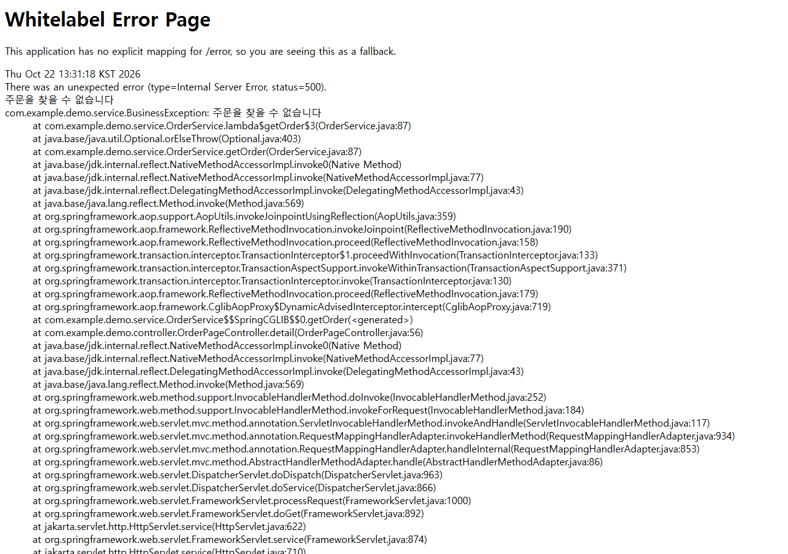
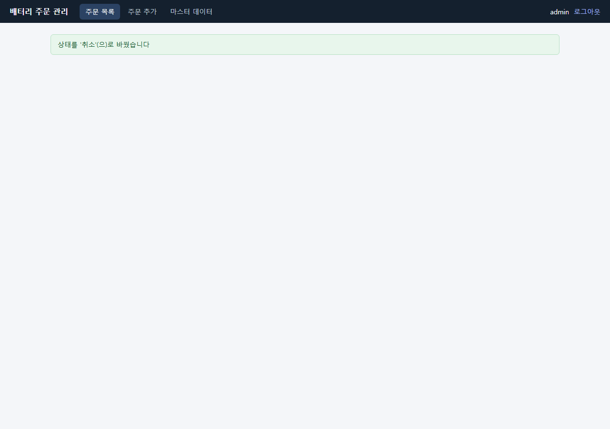
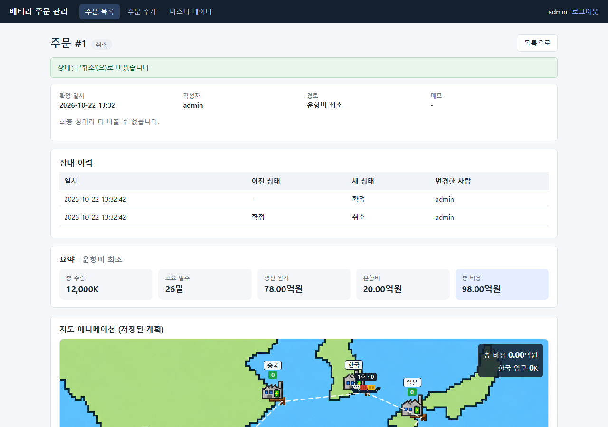
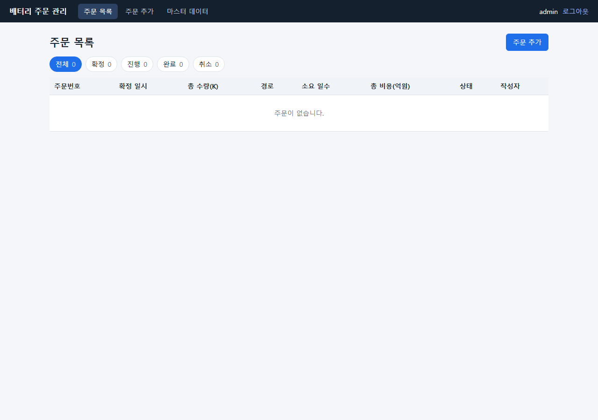
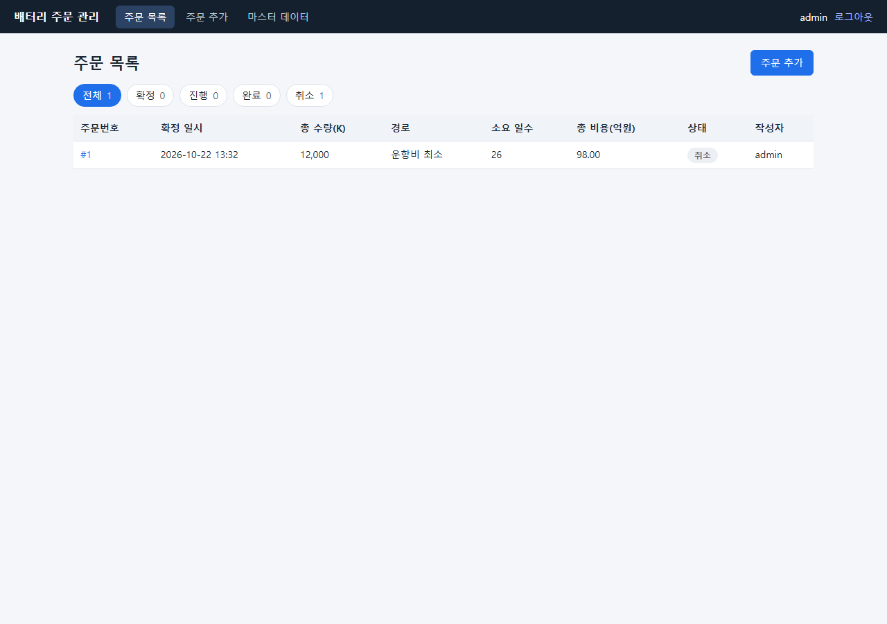
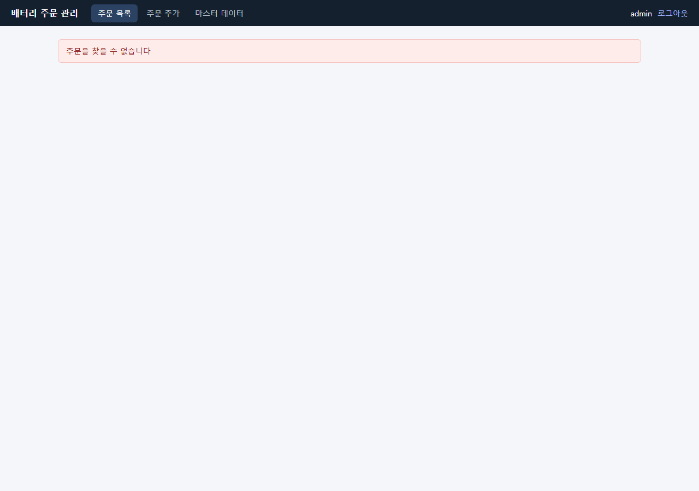
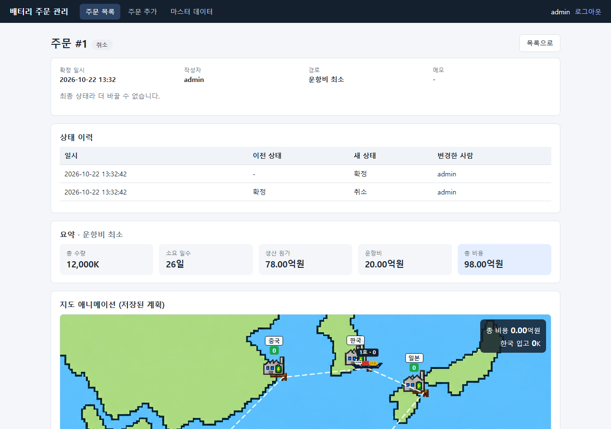

# 취소 오류 수정 Evidence — 취소한 주문을 삭제하지 않고 '취소' 상태로 남김

> 문제: 확정·진행 상태의 주문에서 **`취소(으)로 변경`을 누르면 오류 화면(HTTP 500)이 나왔습니다.** 서버가 취소와 함께 주문을 **삭제**한 뒤 삭제된 주문의 상세 화면을 열었기 때문입니다.
> 수정: 취소해도 주문을 지우지 않고 **'취소' 상태의 최종 상태로 남깁니다.** (팀 설명 자료의 기준이며 E2E T26이 이 기준으로 작성되어 있었습니다.)
> 이 PR은 **PR #27(리팩토링 2)을 기반**으로 만들었습니다(화면 코드가 그 PR에 있음). #27이 먼저 병합되어야 합니다.

## 1. 한눈에 보기

| 항목 | 원래 코드 (Thymeleaf, `e85a792`) | PR #27 (`91ed7d6`) | 이 PR |
|---|---|---|---|
| 취소 버튼을 누른 직후 | **오류 화면(HTTP 500)** | 안내 문구만 보이고 상세는 사라짐 | **상세가 그대로 열리고 상태가 '취소'로 바뀜** |
| 서버 응답 | `302` → 500 | `200` | `200` |
| 취소한 주문을 다시 열면 | 500 오류 화면 | "주문을 찾을 수 없습니다" | **'취소' 상태 상세가 열림** |
| 목록의 '취소' 칩 | 항상 0 | 항상 0 | **실제 취소 건수** |
| 단위·통합 테스트 | 81개 | 86개 | **89개 통과** (실패 0) |
| E2E (Playwright 44개) | 39 통과 / 5 실패 | 41 통과 / 3 실패 | **42 통과 / 2 실패** (2번 반복, 같은 결과) |

**E2E: T26이 실패 → 통과로 바뀌고, 통과 → 실패로 바뀐 테스트는 없습니다.** 남은 실패 2개(S5, No.36)는 취소와 무관한 기존 결함(깨진 요청의 오류 응답에 서버 내부 정보 `trace` 포함)입니다.

## 2. 화면 전/후 (확정 주문에서 `취소(으)로 변경` 클릭)
같은 순서(주문 확정 → 취소 클릭 → 목록 → 취소한 주문 다시 열기)로 세 코드에서 찍은 화면입니다(1280x900).

| 시점 | 원래 코드 | PR #27 | 이 PR |
|---|---|---|---|
| 취소 클릭 직후 |  |  |  |
| 목록 |  |  |  |
| 취소한 주문 다시 열기 |  |  |  |

측정값(같은 스크립트로 수집):

| | 원래 코드 | PR #27 | 이 PR |
|---|---|---|---|
| 취소 요청 응답 | `302 POST /orders/1/status` | `200 POST /api/orders/1/status` | `200 POST /api/orders/1/status` |
| 오류 화면(Whitelabel) | 있음 | 없음 | 없음 |
| 취소 후 목록 칩 | 전체 0 / 확정 0 / 진행 0 / 완료 0 / 취소 0 | 전체 0 / … / 취소 0 | **전체 1 / 확정 0 / 진행 0 / 완료 0 / 취소 1** |
| 다시 열기 | HTTP 500 | HTTP 200, "주문을 찾을 수 없습니다" | HTTP 200, "주문 #1 취소", 상태 이력 2건 |

## 3. 무엇을 바꿨나
| 파일 | 변경 |
|---|---|
| `OrderService.changeStatus` | 취소(`CANCELED`)해도 `orders.delete(order)`를 하지 않음. 상태 이력(확정 → 취소)은 그대로 기록 |
| `static/js/order-detail.js` | 취소만 다르게 처리하던 코드(상세를 숨기고 안내만 표시)를 지워, 다른 상태 변경과 같이 다시 불러와 '취소' 상태와 "최종 상태라 더 바꿀 수 없습니다."를 보여 줌 |

그 밖의 코드(목록·상태별 개수·이력 조회)는 **바꾸지 않았습니다.** 삭제만 안 하면 기존 코드가 그대로 '취소' 주문을 목록·개수에 포함합니다(상태별 개수의 합이 전체 주문 수라는 전제는 그대로 성립).

## 4. 동작이 같다는 근거 / 달라진 점

### 4-1. 단위·통합 테스트 (`./gradlew test`)
| 클래스 | 테스트 수 | 실패 |
|---|---|---|
| `AuthApiControllerAccountTest` | 3 | 0 |
| `DemoApplicationTests` | 1 | 0 |
| `OrderFlowTests` | 9 | 0 |
| `ServiceBehaviorTest` | 31 | 0 |
| `WebBehaviorTest` | 31 | 0 |
| `simulation.PlannerGoldenTest` | 2 | 0 |
| `simulation.PlannerTest` | 12 | 0 |
| **합계** | **89** | **0** |

- **먼저 테스트를 바꿔 실패를 확인한 뒤 고쳤습니다.** 새 기대값으로 바꾼 테스트 4개가 수정 전 코드에서 실패하는 것을 확인하고(89개 중 4개 실패), 수정 후 모두 통과했습니다.
- 취소 시 삭제를 단언하던 테스트(`cancelDeletesTheOrderButKeepsTheHistory`, `statusChangeRecordsTheLoggedInUserAndCancelDeletesTheOrder`)는 '취소 상태로 남음'으로 바꿨습니다. PR #26 리뷰에서 "T26을 고칠 때 함께 바꿔야 한다"고 메모했던 부분입니다.
- 새로 추가: `inProgressOrderCanBeCanceledToo`(진행 중 취소), `canceledOrderIsFinalAndCannotBeChangedAgain`(취소 후 모든 상태로의 재변경 거절, 문구 확인), `canceledOrderStaysVisibleAsFinalState`(상세·목록 API에서 '취소'로 보임).
- 리팩토링에서 만든 golden 기준 파일(`planner.txt`, `simulate-default.json`)은 **바꾸지 않았고** 그대로 통과합니다.

### 4-2. 달라진 점
1. **취소한 주문이 DB에 남고 목록에 보입니다.** 목록의 "전체" 건수와 "취소" 칩이 취소 주문을 포함합니다. 이전에는 취소 주문이 목록에서 사라졌습니다(그리고 오류 화면이 나왔습니다).
2. **취소된 주문은 최종 상태입니다.** 완료와 같이 더 바꿀 수 없고(상태 변경 버튼 없음, API는 400 `취소 상태에서는 …(으)로 바꿀 수 없습니다`), 상세·상태 이력을 계속 볼 수 있습니다.
3. 취소 주문이 쌓이므로 주문 데이터는 이전보다 늘어납니다. 정리(삭제)가 필요하면 별도 기능으로 다뤄야 합니다.
4. **문서는 고치지 않았습니다.** `CLAUDE.md`(로컬 파일), PRD/INTENT 일부에 "취소하면 주문이 삭제된다"는 설명이나 "결정 전"이라는 표시가 남아 있을 수 있습니다. 후속 정리 대상입니다.

## 5. E2E 결과 (44개, 테스트별)
전: PR #27의 코드와 테스트, 후: 이 PR. 둘 다 인메모리 DB를 쓰는 새 서버에서 실행했습니다.

**41 통과 / 3 실패 → 42 통과 / 2 실패**, 결과가 달라진 테스트: T26 주문 상태: 확정·진행 상태에서 취소 (결함 후보) → T26 주문 상태: 확정·진행 상태에서 취소

| 파일 | 시나리오 | 전 | 후 | 비고 |
|---|---|---|---|---|
| `gauge-linkage.spec.ts` | No.8 수량 게이지 연동: 오른쪽 나라가 반대로 조정 | 통과 | 통과 |  |
| `login-success.spec.ts` | No.1 올바른 계정으로 로그인하면 주문 목록으로 이동 | 통과 | 통과 |  |
| `login.spec.ts` | TC-E2E-001 로그인 → 주문 목록 → 로그아웃 | 통과 | 통과 |  |
| `master-change-confirm-conflict.spec.ts` | No.18 시뮬레이션 뒤 기준값이 바뀌면 확정 거절 | 통과 | 통과 |  |
| `master-change-keeps-order.spec.ts` | No.35 기준값 변경은 이미 확정된 주문의 계획을 바꾸지 않음 | 통과 | 통과 |  |
| `master-default-values.spec.ts` | No.28 기본 기준값 표시 | 통과 | 통과 |  |
| `menu-navigation.spec.ts` | No.5 상단 메뉴로 화면 이동과 현재 메뉴 강조 | 통과 | 통과 |  |
| `order-list-layout.spec.ts` | No.20 목록 화면 구성과 이동(주문 추가, 행 클릭) | 통과 | 통과 |  |
| `order-status-flow.spec.ts` | No.22 핵심 업무 흐름: 확정 → 진행 → 완료, 완료는 최종 상태 | 통과 | 통과 |  |
| `robustness.spec.ts` | S1 인증·접근 통제: 로그인 없이, 로그아웃 후 보호 기능 접근 차단 | 통과 | 통과 |  |
| `robustness.spec.ts` | S3 입력 검증: 총 수량 상한(100,000K) 초과 입력 | 통과 | 통과 |  |
| `robustness.spec.ts` | S4 입력 검증: 화면 제한을 우회한 메모 1,001자 확정 요청 | 통과 | 통과 |  |
| `robustness.spec.ts` | S5 요청 형식: 깨진 요청 뒤에도 앱이 정상 동작 | 실패 | 실패 | 기존 결함(그대로) |
| `robustness.spec.ts` | S7 기준값: 시뮬레이션 뒤 기준값이 바뀌면 확정 거절 | 통과 | 통과 |  |
| `robustness.spec.ts` | S8 주문 상태: 허용되지 않는 상태 변경(확정 → 완료) 거절 | 통과 | 통과 |  |
| `robustness.spec.ts` | S10 오류 처리: 존재하지 않는 주문 번호 접근 | 통과 | 통과 |  |
| `scenarios-sy9169park.spec.ts` | [T02] 로그인: 잘못된 계정 정보로 로그인 실패 | 통과 | 통과 |  |
| `scenarios-sy9169park.spec.ts` | [T07] 주문 추가: 총 생산 필요 수 변경 시 4개국 균등 분배, 잘못된 값은 이전 값으로 복구 | 통과 | 통과 |  |
| `scenarios-sy9169park.spec.ts` | [T11] 주문 추가: 경로안 선택 전환 시 화면 갱신 | 통과 | 통과 |  |
| `scenarios-sy9169park.spec.ts` | [T14] 입력 검증: 수량 0, 음수 요청 거절 | 통과 | 통과 |  |
| `scenarios-sy9169park.spec.ts` | [T16] 주문 확정: 메모 없이 확정하면 목록 최상단에 반영 | 통과 | 통과 |  |
| `scenarios-sy9169park.spec.ts` | [T23] 주문 상태: 확정 상태의 변경 버튼 확인과 확인창 취소 시 변화 없음 | 통과 | 통과 |  |
| `scenarios-sy9169park.spec.ts` | [T25] 동시성: 두 탭에서 같은 주문을 동시에 변경하면 나중 요청은 거절 | 통과 | 통과 |  |
| `scenarios-sy9169park.spec.ts` | [T30] 마스터 데이터: 잘못된 기준값은 모두 안내하고 아무것도 저장하지 않음 | 통과 | 통과 |  |
| `scenarios-sy9169park.spec.ts` | [T31] 마스터 데이터: 척당 일 운항비 입력 검증 | 통과 | 통과 |  |
| `simulation-result-visibility.spec.ts` | No.12 시뮬레이션 전 확정 영역 숨김, 입력을 바꾸면 이전 결과 사라짐 | 통과 | 통과 |  |
| `ssw60040-prog.spec.ts` | No.4 로그인 상태에서 /login 또는 / 접속 시 주문 목록으로 이동 | 통과 | 통과 |  |
| `ssw60040-prog.spec.ts` | No.9 게이지 경계값 보정(초과·음수) | 통과 | 통과 |  |
| `ssw60040-prog.spec.ts` | No.13 총 수량 상한(100,000K) 초과 거절과 복구 | 통과 | 통과 |  |
| `ssw60040-prog.spec.ts` | No.19 확정된 주문 상세에 저장된 계획 표시 | 통과 | 통과 |  |
| `ssw60040-prog.spec.ts` | No.21 상태 필터와 건수 집계 일치 | 통과 | 통과 |  |
| `ssw60040-prog.spec.ts` | No.24 허용되지 않는 상태 변경(확정 → 완료) 요청 거절 | 통과 | 통과 |  |
| `ssw60040-prog.spec.ts` | No.32 배 척수 범위(1~4): 화면 검증과 우회 요청 거절 | 통과 | 통과 |  |
| `ssw60040-prog.spec.ts` | No.33 저장한 기준값이 이후 시뮬레이션에 반영 | 통과 | 통과 |  |
| `ssw60040-prog.spec.ts` | No.36 깨진 요청 뒤에도 앱이 정상 동작 | 실패 | 실패 | 기존 결함(그대로) |
| `team-ctkim1005.spec.ts` | T03 접근 통제: 로그인 없이, 로그아웃 후 보호 기능 접근 차단 | 통과 | 통과 |  |
| `team-ctkim1005.spec.ts` | T06 주문 추가: 기본 수량(12,000K)으로 시뮬레이션과 방문 횟수 표시 | 통과 | 통과 |  |
| `team-ctkim1005.spec.ts` | T10 주문 추가: 수량이 0인 나라가 있어도 시뮬레이션 | 통과 | 통과 |  |
| `team-ctkim1005.spec.ts` | T15 주문 확정: 경로안 선택 후 메모와 함께 확정 | 통과 | 통과 |  |
| `team-ctkim1005.spec.ts` | T17 주문 확정: 메모 1,000자 제한 — 화면 입력 제한과 우회 요청 거절 | 통과 | 통과 |  |
| `team-ctkim1005.spec.ts` | T26 주문 상태: 확정·진행 상태에서 취소 (결함 후보) → T26 주문 상태: 확정·진행 상태에서 취소 | 실패 | 통과 | **실패 → 통과** |
| `team-ctkim1005.spec.ts` | T27 주문 상태: 존재하지 않는 주문 번호 접근 (결함 후보) | 통과 | 통과 |  |
| `team-ctkim1005.spec.ts` | T29 마스터 데이터: 값 수정 후 저장하면 유지됨 | 통과 | 통과 |  |
| `team-ctkim1005.spec.ts` | T34 마스터 데이터: 항로 일수 변경 시 소요일 증가 | 통과 | 통과 |  |

### E2E 테스트 코드 변경 (팀 공용 테스트라 이유를 적습니다)
| 파일 | 변경 | 이유 |
|---|---|---|
| `team-ctkim1005.spec.ts` T26 | 취소 후 칩 개수를 읽기 전에 `/orders`로 이동, '결함 후보' 표시와 `known-issue` 주석 제거 | 칩은 목록 화면에만 있는데 상세 화면에서 읽어 **20초 동안 기다리다 시간 초과**되고 있었음(앱이 정상이어도 실패). 이제 이 시나리오는 결함이 아님 |
| `ssw60040-prog.spec.ts` No.21 | 전체 목록의 상태 집합이 `{확정, 진행, 완료}`와 **정확히 같다**는 단언을, 세 상태가 모두 있고 허용 상태(확정·진행·완료·취소) 밖의 것이 없다는 단언으로 변경 | 이전에는 취소 주문이 삭제되어 목록에 "취소"가 없다는 가정이었음. 다른 시나리오가 정리하며 취소한 주문이 목록에 남게 되므로 가정이 맞지 않게 됨 |
| `helpers.ts` `removeOrder` | 화면에서 변경 번호를 읽는 방식 → `GET /api/orders/{id}`로 상태와 version 을 읽고 `POST /api/orders/{id}/status`로 취소 (이미 완료·취소면 건너뜀) | 이미 취소된 주문의 상태 변경 버튼을 화면에서 기다리다 시간이 낭비되는 것을 막음 |

## 6. 직접 재현하기
리팩토링 1 Evidence(`docs/evidence/sy9169/refactoring-1/README.md`) 5번의 순서와 같습니다.
- 전: PR #27 브랜치(`feature-sy9169-mission2-refactoring`), 후: 이 PR 브랜치를 체크아웃하고 **서버를 새로 띄워서** E2E를 실행합니다.
- 기대 결과: 단위·통합 전 86개 / 후 89개 모두 `BUILD SUCCESSFUL`. E2E 전 `3 failed, 41 passed`(S5, No.36, T26), 후 `2 failed, 42 passed`(S5, No.36).
- 화면으로 직접 확인: 서버 실행 후 확정 주문을 만들어 `취소(으)로 변경`을 누르면 상세가 '취소' 상태로 남아야 합니다.

## 7. 한계
- 취소 주문의 보관 기간·정리·숨김 같은 정책은 정하지 않았습니다(범위 밖).
- 취소 주문이 목록의 "전체" 건수에 포함되는 것이 맞는지(별도 표시할지)는 팀 결정이 필요합니다. 현재는 모든 상태를 합친 값입니다.
- 위 스크린샷은 크롬(Playwright) 1280px 기준입니다.
