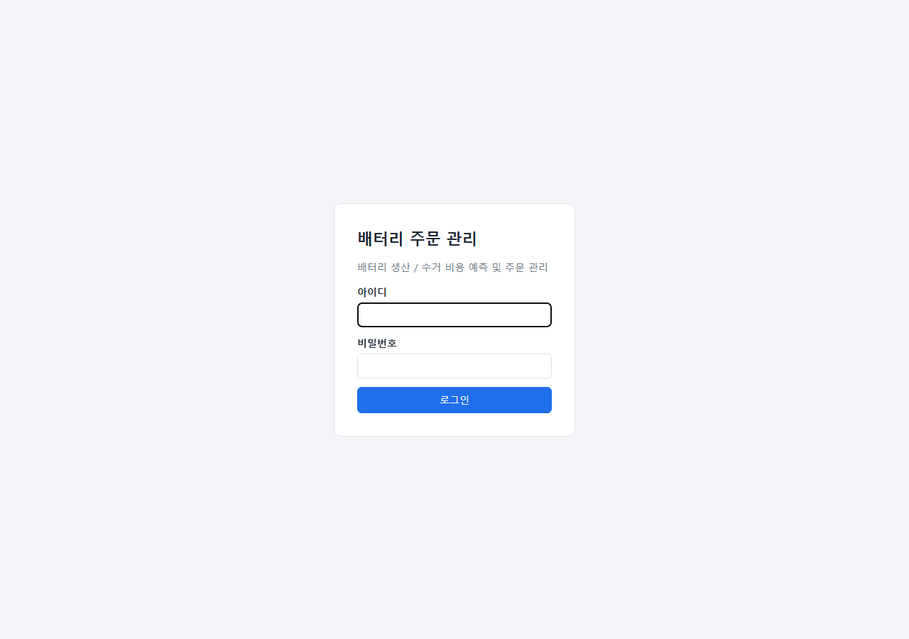
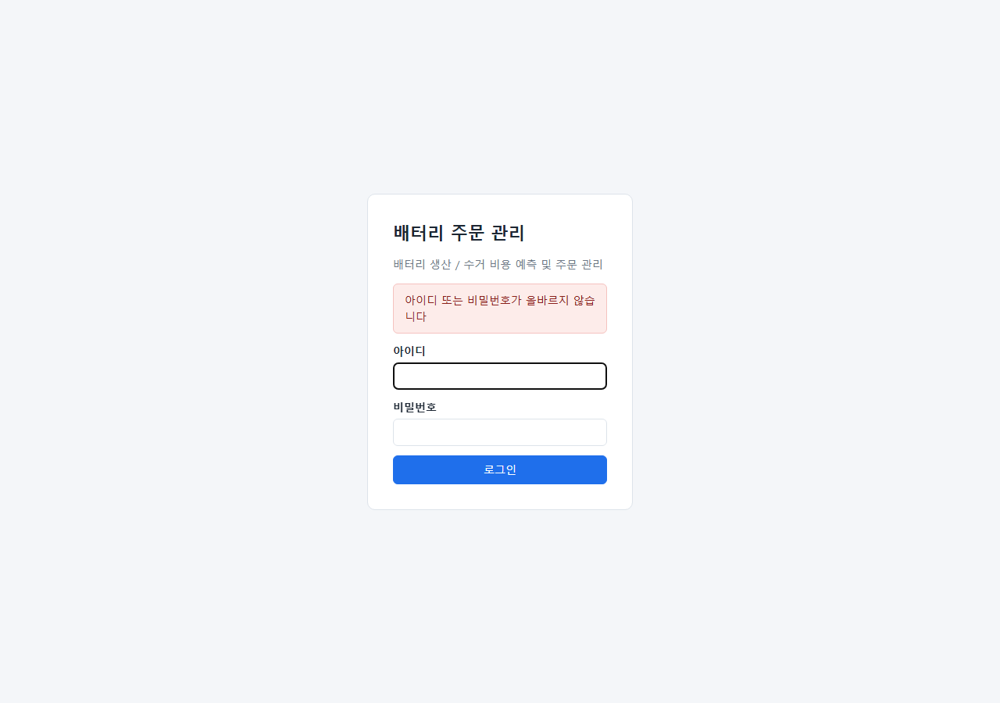
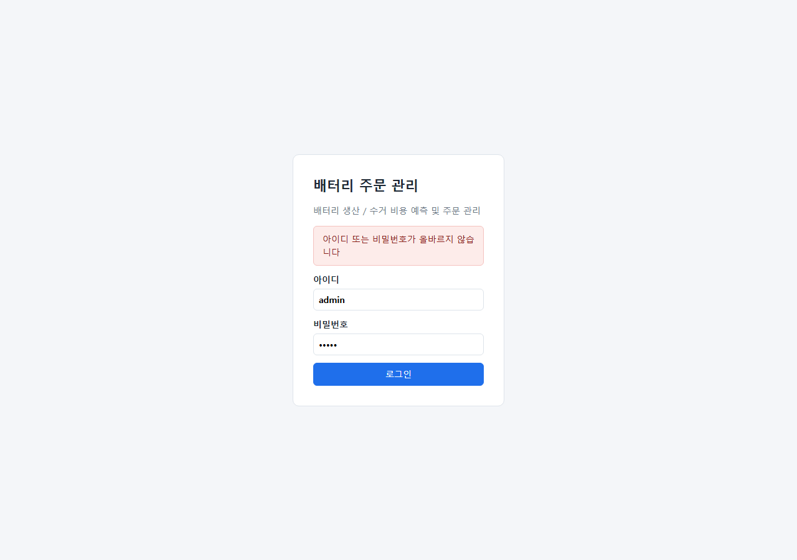
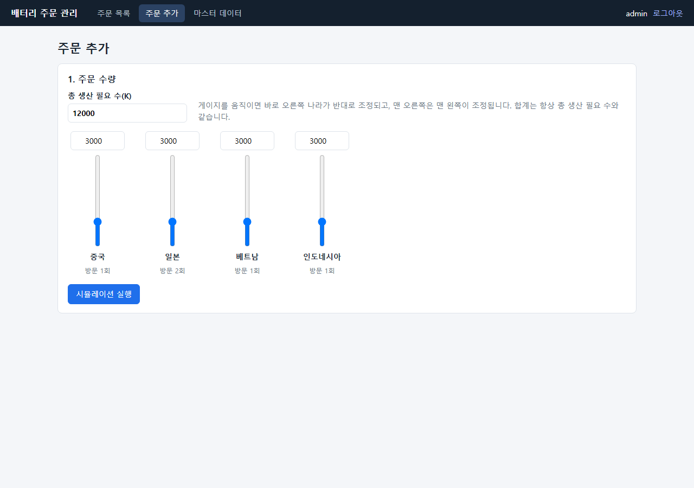
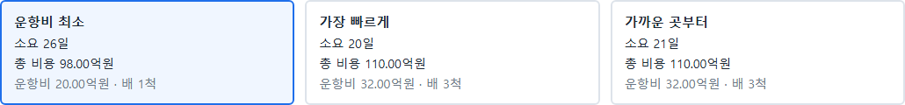
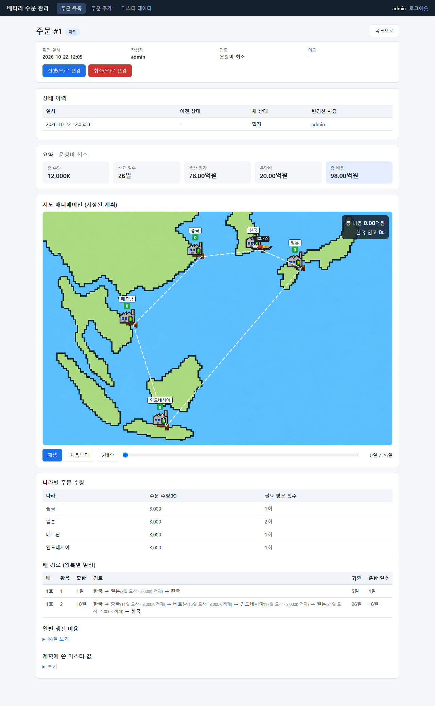
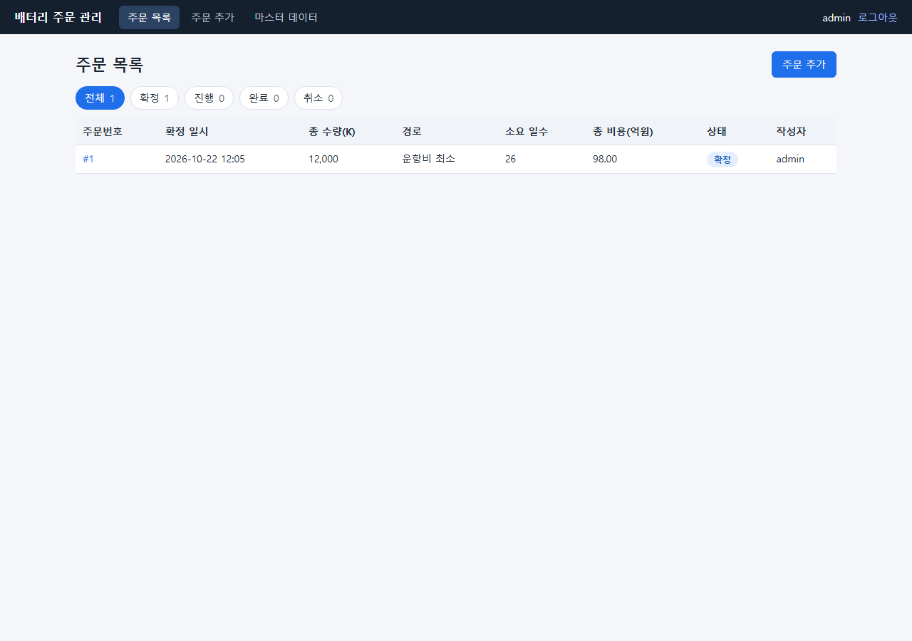
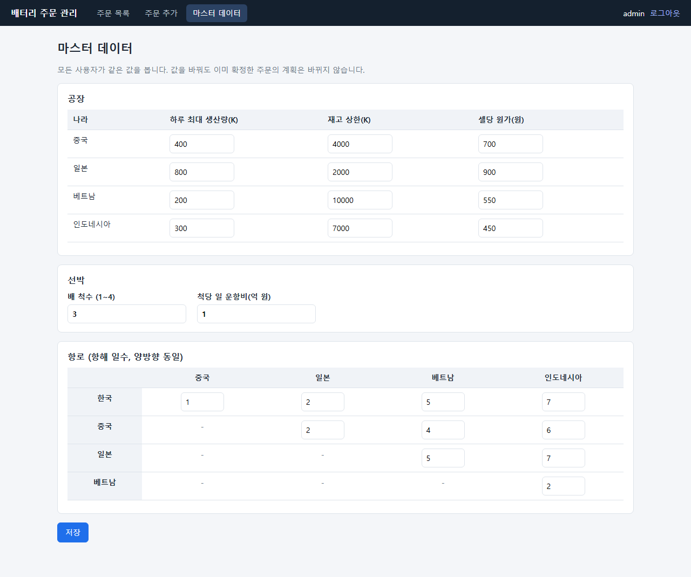
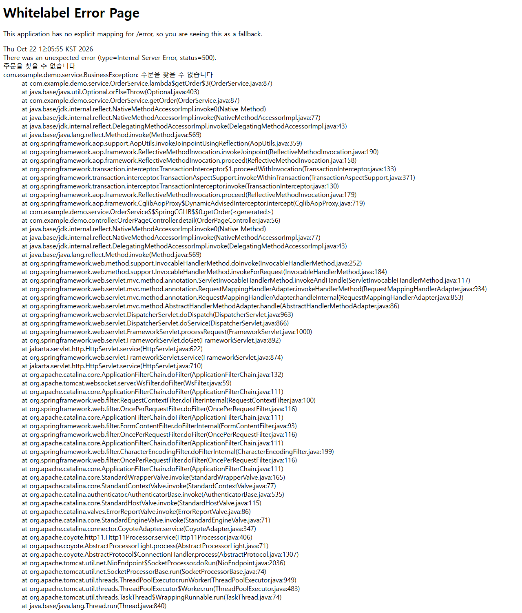

# 리팩토링 2 Evidence — 프론트엔드를 Thymeleaf에서 HTML/JavaScript + JSON API로 변경

> 이 문서는 **리팩토링 2 전(`e85a792`, 리팩토링 1과 PR #26 리뷰 반영이 끝난 코드)과 후**의 결과를 비교할 수 있도록 모은 것입니다.
> 리팩토링 1과 달리 이번에는 **API 주소와 화면 구현이 바뀌므로 "동작이 완전히 같다"가 아니라 "화면이 같고, 달라진 점은 아래에 모두 적었다"** 가 기준입니다. 팀원은 4~6번을 직접 확인하고 부족한 점을 PR에 Comment로 남겨 주세요.

## 1. 한눈에 보기

| 항목 | 전 | 후 |
|---|---|---|
| 화면 구현 | Thymeleaf 템플릿 6개(서버가 `Model`로 화면을 채움) | 정적 HTML 5개 + JavaScript (데이터는 JSON API로 가져옴) |
| Thymeleaf 참조(`src`, `build.gradle.kts`) | 8개 파일 | **0개** |
| 화면 주소 | `/login`, `/orders`, `/orders/new`, `/orders/{id}`, `/master` | **그대로** (서버가 정적 파일로 연결) |
| 단위·통합 테스트 | 81개 통과 | **86개 통과** (실패 0) |
| E2E (Playwright 44개) | 39 통과 / 5 실패 | **41 통과 / 3 실패** (3번 반복 실행해 매번 같은 결과) |
| 화면 모양 | — | 8개 화면 전/후 스크린샷이 사실상 같음 (6번) |

**E2E: 전에 통과하던 39개는 후에도 모두 통과하고, 전에 실패하던 5개 중 2개(S10, T27)가 통과로 바뀌었습니다. 나머지 3개(S5, No.36, T26)는 기존 결함 그대로입니다.** 통과 → 실패로 바뀐 테스트는 없습니다.

## 2. 무엇이 바뀌었나

### 2-1. 구조 전/후
**전 — 서버가 화면을 만들던 파일**

| 파일 | 줄 수 |
|---|---|
| `controller/AuthController.java` | 50 |
| `controller/OrderPageController.java` | 73 |
| `controller/MasterPageController.java` | 52 |
| `controller/ApiController.java` | 68 |
| `controller/LoginUserAdvice.java` | 16 |
| `templates/fragments.html` | 23 |
| `templates/login.html` | 16 |
| `templates/master.html` | 66 |
| `templates/order-detail.html` | 75 |
| `templates/order-new.html` | 52 |
| `templates/orders.html` | 47 |

**후 — JSON API와 화면 연결 (`controller/`)**

| 파일 | 줄 수 |
|---|---|
| `controller/dto/HistoryEntry.java` | 16 |
| `controller/dto/OrderDetail.java` | 21 |
| `controller/dto/OrderList.java` | 8 |
| `controller/dto/OrderSummary.java` | 16 |
| `controller/dto/StatusInfo.java` | 11 |
| `controller/ApiExceptionHandler.java` | 24 |
| `controller/AuthApiController.java` | 65 |
| `controller/MasterApiController.java` | 41 |
| `controller/OrderApiController.java` | 73 |
| `controller/PageController.java` | 48 |
| `controller/SimulationApiController.java` | 30 |

**후 — 화면 (`src/main/resources/static/`)**

| 파일 | 줄 수 |
|---|---|
| `static/js/anim.js` | 243 |
| `static/js/common.js` | 87 |
| `static/js/login.js` | 24 |
| `static/js/master.js` | 68 |
| `static/js/order-detail.js` | 77 |
| `static/js/order-new.js` | 181 |
| `static/js/orders.js` | 40 |
| `static/js/planview.js` | 88 |
| `static/login.html` | 23 |
| `static/master.html` | 25 |
| `static/order-detail.html` | 51 |
| `static/order-new.html` | 57 |
| `static/orders.html` | 34 |

- 화면 주소와 정적 파일 연결은 `PageController` 한 곳이 맡습니다. 로그인한 사용자가 `/login`을 열면 `/orders`로 보내는 처리도 서버에 있습니다.
- 모든 JSON API의 업무 오류는 `ApiExceptionHandler` 한 곳에서 `{error, conflict, errors}`로 응답합니다.
- 응답 형태는 `controller/dto`의 record로 정의했습니다(`OrderList`, `OrderSummary`, `OrderDetail`, `HistoryEntry`, `StatusInfo`).
- 서버에서 온 값(메모, 작성자 등)은 화면에서 `textContent`로만 넣어 HTML로 해석되지 않습니다(이전 Thymeleaf의 자동 이스케이프와 같은 효과).

### 2-2. Thymeleaf 제거 확인
- 전 `e85a792`: `git grep -il thymeleaf` 결과 **8개 파일** — `build.gradle.kts`, `src/main/resources/application.properties`, `src/main/resources/templates/fragments.html`, `src/main/resources/templates/login.html`, `src/main/resources/templates/master.html`, `src/main/resources/templates/order-detail.html`, `src/main/resources/templates/order-new.html`, `src/main/resources/templates/orders.html`
- 후: **0개 파일**. `build.gradle.kts`에서 `spring-boot-starter-thymeleaf`, `spring-boot-starter-thymeleaf-test`를 지웠고 `spring.thymeleaf.cache` 설정과 `templates/` 폴더도 삭제했습니다.

### 2-3. 화면 주소 연결 (`PageController`)
| 주소 | 하는 일 |
|---|---|
| `/` | `/orders`로 이동 |
| `/login` | 이미 로그인했으면 `/orders`로 이동, 아니면 `login.html` |
| `/orders` | `orders.html` |
| `/orders/new` | `order-new.html` |
| `/orders/{id}` | `order-detail.html` (주문 번호는 화면의 JavaScript가 주소에서 읽음) |
| `/master` | `master.html` |

로그인하지 않으면 이 화면들과 `.html` 파일을 직접 열어도 `/login`으로 이동합니다(`LoginInterceptor`, 테스트로 확인).

### 2-4. JSON API (모두 로그인 필요, 단 `/api/login` 제외)
| 방법 | 주소 | 요청 | 응답 | 전에는 |
|---|---|---|---|---|
| POST | `/api/login` | `{username, password}` | 200 `{username}` / 401 `{error}` | 폼 `POST /login` |
| POST | `/api/logout` | - | 204 | 폼 `POST /logout` |
| GET | `/api/me` | - | `{username}` | 화면 모델 `loginUser` |
| GET | `/api/orders?status=` | - | `{orders[], counts, total, statuses[]}` | 화면 모델 |
| GET | `/api/orders/{id}` | - | `{id, confirmedAt, createdBy, routeLabel, memo, status, version, nextStatuses[], history[], plan}` | 화면 모델 |
| POST | `/api/orders` | `{orders, routeType, masterVersion, memo}` | `{id}` | **그대로** |
| POST | `/api/orders/{id}/status` | `{status, version}` | `{message}` / 400·409 `{error, conflict, errors}` | 폼 `POST /orders/{id}/status` + 리다이렉트 |
| GET | `/api/master` | - | 마스터 값 스냅샷(버전 포함) | **그대로** |
| GET | `/api/master/form` | - | 입력칸 이름 → 값 | 화면 모델 `form` |
| POST | `/api/master` | 입력칸 이름 → 값 | `{message}` / 400 `{error, conflict, errors}` | 폼 `POST /master` + 리다이렉트 |
| POST | `/api/simulate` | `{orders}` | 경로 3종 | **그대로** |

### 2-5. 실제 응답 샘플 (후, 실행 중인 서버에서 수집)
`GET /api/orders`
```json
{
  "orders": [
    {
      "id": 1,
      "confirmedAt": "2026-10-22 12:06",
      "totalK": 12000,
      "routeLabel": "운항비 최소",
      "totalDays": 26,
      "totalCostEok": "98.00",
      "status": {
        "name": "CONFIRMED",
        "label": "확정"
      },
      "createdBy": "admin"
    }
  ],
  "counts": {
    "CONFIRMED": 1,
    "IN_PROGRESS": 0,
    "COMPLETED": 0,
    "CANCELED": 0
  },
  "total": 1,
  "statuses": [
    {
      "name": "CONFIRMED",
      "label": "확정"
    },
    {
      "name": "IN_PROGRESS",
      "label": "진행"
    },
    {
      "name": "COMPLETED",
      "label": "완료"
    },
    {
      "name": "CANCELED",
      "label": "취소"
    }
  ]
}
```
`GET /api/orders/{id}` (계획 부분은 길어서 요약)
```json
{
  "id": 1,
  "confirmedAt": "2026-10-22 12:06",
  "createdBy": "admin",
  "routeLabel": "운항비 최소",
  "memo": null,
  "status": {
    "name": "CONFIRMED",
    "label": "확정"
  },
  "version": 0,
  "nextStatuses": [
    {
      "name": "IN_PROGRESS",
      "label": "진행"
    },
    {
      "name": "CANCELED",
      "label": "취소"
    }
  ],
  "history": [
    {
      "changedAt": "2026-10-22 12:06:59",
      "from": null,
      "to": {
        "name": "CONFIRMED",
        "label": "확정"
      },
      "changedBy": "admin"
    }
  ],
  "plan": {
    "master": "(생략)",
    "orders": {
      "CHINA": 3000,
      "JAPAN": 3000,
      "VIETNAM": 3000,
      "INDONESIA": 3000
    },
    "visits": {
      "CHINA": 1,
      "JAPAN": 2,
      "VIETNAM": 1,
      "INDONESIA": 1
    },
    "plan": {
      "type": "COST",
      "label": "운항비 최소",
      "totalDays": 26,
      "...": "(ships/stock/production 생략)"
    }
  }
}
```
`GET /api/master/form` (일부)
```json
{
  "stockLimit_JAPAN": "2000",
  "unitCost_INDONESIA": "450",
  "maxDaily_JAPAN": "800",
  "stockLimit_VIETNAM": "10000",
  "days_KOREA_VIETNAM": "5",
  "days_JAPAN_INDONESIA": "7",
  "...": "(총 28개 입력칸)"
}
```
`POST /api/master` 에 잘못된 값을 보냈을 때 (배 척수 9, 운항비 `abc`)
```json
{
  "status": 400,
  "conflict": false,
  "errorsCount": 24,
  "firstErrors": [
    "배 척수은(는) 1 이상 4 이하의 정수여야 합니다",
    "척당 일 운항비(억 원)는 숫자로 입력하세요",
    "중국 하루 최대 생산량은(는) 정수로 입력하세요"
  ],
  "errorPreview": "배 척수은(는) 1 이상 4 이하의 정수여야 합니다 / 척당 일 운항비(억 원)는 숫자로 입력하세요 / 중국 하루 최대 생산량은(는) 정수로 입..."
}
```
`GET /api/orders/999999` (없는 주문)
```json
{
  "status": 400,
  "body": {
    "error": "주문을 찾을 수 없습니다",
    "conflict": false,
    "errors": [
      "주문을 찾을 수 없습니다"
    ]
  }
}
```

## 3. 동작이 같다는 근거 / 달라진 점

### 3-1. 단위·통합 테스트 (`./gradlew test`)
| 클래스 | 테스트 수 | 실패 |
|---|---|---|
| `AuthApiControllerAccountTest` | 3 | 0 |
| `DemoApplicationTests` | 1 | 0 |
| `OrderFlowTests` | 9 | 0 |
| `ServiceBehaviorTest` | 29 | 0 |
| `WebBehaviorTest` | 30 | 0 |
| `simulation.PlannerGoldenTest` | 2 | 0 |
| `simulation.PlannerTest` | 12 | 0 |
| **합계** | **86** | **0** |

- 리팩토링 1에서 만든 **golden 기준 파일(`planner.txt`, `simulate-default.json`)은 한 글자도 바꾸지 않았고** 그대로 통과합니다. 경로 계산과 `/api/simulate` 응답은 전과 같습니다.
- 화면 모델(`model().attribute`)과 폼 요청을 검사하던 `AppControllerBehaviorTest`는 같은 내용을 JSON API 응답으로 검사하는 `WebBehaviorTest`(30개)로 바꿨습니다. 주문 목록·상세·상태 변경·마스터 저장·로그인·접근 통제를 모두 API 응답으로 확인합니다.
- 주문 상세 API의 `plan`이 확정 때 저장한 JSON과 같은지(`detailPlanEqualsTheStoredPlanJson`)를 확인해, 화면의 계획 표시가 전과 같은 데이터로 그려지게 했습니다.

### 3-2. 달라진 점 (의도한 것과 부수적인 것 모두)
1. **폼 요청 주소가 사라졌습니다.** `POST /login`, `/logout`, `/master`, `/orders/{id}/status`가 JSON API로 바뀌었습니다. 화면은 이 API를 부르므로 사용자가 보는 흐름은 같지만, **직접 이 주소로 폼을 보내던 코드는 동작하지 않습니다.** E2E 테스트 코드 5개 파일에서 그런 호출 7곳(헬퍼 포함)을 새 주소로 고쳤습니다(5번 참고).
2. **화면 이동 방식이 달라졌습니다.** 상태 변경과 마스터 저장은 전에는 서버가 리다이렉트로 화면을 다시 그렸고, 이제는 같은 화면에서 결과 메시지를 띄우고 값을 다시 읽어 갱신합니다(주소가 바뀌지 않음). 메시지 문구는 같습니다.
3. **없는 주문 번호를 열어도 오류 화면(HTTP 500)이 나오지 않습니다.** 화면은 정상으로 열리고 "주문을 찾을 수 없습니다" 안내가 나오며 메뉴를 쓸 수 있습니다(스크린샷 `08`). 그 결과 기존 결함이던 E2E **S10, T27이 통과**하게 되었습니다. **의도한 수정이 아니라 화면 구조가 바뀌면서 생긴 부수 효과**라서 별도로 밝혀 둡니다. API(`GET /api/orders/{id}`)는 그 경우 400과 이유를 돌려줍니다.
4. 로그인 실패 시 **입력한 아이디가 지워지지 않습니다**(전에는 서버가 화면을 다시 그리며 비웠음, 스크린샷 `02`).
5. 화면이 **데이터를 받은 뒤에 그려집니다**. 느린 환경에서는 잠깐 빈 화면이 보일 수 있습니다. E2E에서 이 타이밍 때문에 생긴 문제는 하나뿐이었습니다(마스터 입력값을 읽는 헬퍼가 입력칸이 그려지기 전에 읽던 것, 기다리도록 수정).
6. 안내 상자(`.alert`)는 전과 같이 **메시지가 있을 때만** 화면에 생깁니다. 처음에는 숨겨 둔 상자를 두었다가 E2E 3개가 실패해서(`.alert`가 항상 존재), 메시지가 있을 때만 만들도록 고쳤습니다.
7. 취소하면 주문이 삭제되는 동작은 **그대로**입니다(T26 기존 결함). 취소 직후에는 "상태를 '취소'(으)로 바꿨습니다" 안내만 보이고 상세는 더 보이지 않습니다.
8. 오류 응답 본문에 `errors`(이유 목록)가 추가되었습니다. 기존 `error`, `conflict` 필드는 그대로입니다.
9. 서버 시작 시 로그인 계정이 기본값(admin/admin)이면 **경고 로그**를 남깁니다(PR #26 리뷰 반영).

## 4. E2E 결과 (44개, 테스트별 전/후)
실행 조건: 인메모리 DB 격리 서버, `BASE_URL`로 지정, 전/후 모두 새로 띄운 서버. 전은 `e85a792`의 테스트 코드, 후는 이 PR의 테스트 코드입니다(테스트 코드 변경은 5번).

**39 통과 / 5 실패 → 41 통과 / 3 실패**, 결과가 달라진 테스트 2개(모두 실패 → 통과).

| 파일 | 시나리오 | 전 | 후 | 비고 |
|---|---|---|---|---|
| `gauge-linkage.spec.ts` | No.8 수량 게이지 연동: 오른쪽 나라가 반대로 조정 | 통과 | 통과 |  |
| `login-success.spec.ts` | No.1 올바른 계정으로 로그인하면 주문 목록으로 이동 | 통과 | 통과 |  |
| `login.spec.ts` | TC-E2E-001 로그인 → 주문 목록 → 로그아웃 | 통과 | 통과 |  |
| `master-change-confirm-conflict.spec.ts` | No.18 시뮬레이션 뒤 기준값이 바뀌면 확정 거절 | 통과 | 통과 |  |
| `master-change-keeps-order.spec.ts` | No.35 기준값 변경은 이미 확정된 주문의 계획을 바꾸지 않음 | 통과 | 통과 |  |
| `master-default-values.spec.ts` | No.28 기본 기준값 표시 | 통과 | 통과 |  |
| `menu-navigation.spec.ts` | No.5 상단 메뉴로 화면 이동과 현재 메뉴 강조 | 통과 | 통과 |  |
| `order-list-layout.spec.ts` | No.20 목록 화면 구성과 이동(주문 추가, 행 클릭) | 통과 | 통과 |  |
| `order-status-flow.spec.ts` | No.22 핵심 업무 흐름: 확정 → 진행 → 완료, 완료는 최종 상태 | 통과 | 통과 |  |
| `robustness.spec.ts` | S1 인증·접근 통제: 로그인 없이, 로그아웃 후 보호 기능 접근 차단 | 통과 | 통과 |  |
| `robustness.spec.ts` | S3 입력 검증: 총 수량 상한(100,000K) 초과 입력 | 통과 | 통과 |  |
| `robustness.spec.ts` | S4 입력 검증: 화면 제한을 우회한 메모 1,001자 확정 요청 | 통과 | 통과 |  |
| `robustness.spec.ts` | S5 요청 형식: 깨진 요청 뒤에도 앱이 정상 동작 | 실패 | 실패 | 기존 결함(그대로) |
| `robustness.spec.ts` | S7 기준값: 시뮬레이션 뒤 기준값이 바뀌면 확정 거절 | 통과 | 통과 |  |
| `robustness.spec.ts` | S8 주문 상태: 허용되지 않는 상태 변경(확정 → 완료) 거절 | 통과 | 통과 |  |
| `robustness.spec.ts` | S10 오류 처리: 존재하지 않는 주문 번호 접근 | 실패 | 통과 | **실패 → 통과** (아래 "동작 차이" 3) |
| `scenarios-sy9169park.spec.ts` | [T02] 로그인: 잘못된 계정 정보로 로그인 실패 | 통과 | 통과 |  |
| `scenarios-sy9169park.spec.ts` | [T07] 주문 추가: 총 생산 필요 수 변경 시 4개국 균등 분배, 잘못된 값은 이전 값으로 복구 | 통과 | 통과 |  |
| `scenarios-sy9169park.spec.ts` | [T11] 주문 추가: 경로안 선택 전환 시 화면 갱신 | 통과 | 통과 |  |
| `scenarios-sy9169park.spec.ts` | [T14] 입력 검증: 수량 0, 음수 요청 거절 | 통과 | 통과 |  |
| `scenarios-sy9169park.spec.ts` | [T16] 주문 확정: 메모 없이 확정하면 목록 최상단에 반영 | 통과 | 통과 |  |
| `scenarios-sy9169park.spec.ts` | [T23] 주문 상태: 확정 상태의 변경 버튼 확인과 확인창 취소 시 변화 없음 | 통과 | 통과 |  |
| `scenarios-sy9169park.spec.ts` | [T25] 동시성: 두 탭에서 같은 주문을 동시에 변경하면 나중 요청은 거절 | 통과 | 통과 |  |
| `scenarios-sy9169park.spec.ts` | [T30] 마스터 데이터: 잘못된 기준값은 모두 안내하고 아무것도 저장하지 않음 | 통과 | 통과 |  |
| `scenarios-sy9169park.spec.ts` | [T31] 마스터 데이터: 척당 일 운항비 입력 검증 | 통과 | 통과 |  |
| `simulation-result-visibility.spec.ts` | No.12 시뮬레이션 전 확정 영역 숨김, 입력을 바꾸면 이전 결과 사라짐 | 통과 | 통과 |  |
| `ssw60040-prog.spec.ts` | No.4 로그인 상태에서 /login 또는 / 접속 시 주문 목록으로 이동 | 통과 | 통과 |  |
| `ssw60040-prog.spec.ts` | No.9 게이지 경계값 보정(초과·음수) | 통과 | 통과 |  |
| `ssw60040-prog.spec.ts` | No.13 총 수량 상한(100,000K) 초과 거절과 복구 | 통과 | 통과 |  |
| `ssw60040-prog.spec.ts` | No.19 확정된 주문 상세에 저장된 계획 표시 | 통과 | 통과 |  |
| `ssw60040-prog.spec.ts` | No.21 상태 필터와 건수 집계 일치 | 통과 | 통과 |  |
| `ssw60040-prog.spec.ts` | No.24 허용되지 않는 상태 변경(확정 → 완료) 요청 거절 | 통과 | 통과 |  |
| `ssw60040-prog.spec.ts` | No.32 배 척수 범위(1~4): 화면 검증과 우회 요청 거절 | 통과 | 통과 |  |
| `ssw60040-prog.spec.ts` | No.33 저장한 기준값이 이후 시뮬레이션에 반영 | 통과 | 통과 |  |
| `ssw60040-prog.spec.ts` | No.36 깨진 요청 뒤에도 앱이 정상 동작 | 실패 | 실패 | 기존 결함(그대로) |
| `team-ctkim1005.spec.ts` | T03 접근 통제: 로그인 없이, 로그아웃 후 보호 기능 접근 차단 | 통과 | 통과 |  |
| `team-ctkim1005.spec.ts` | T06 주문 추가: 기본 수량(12,000K)으로 시뮬레이션과 방문 횟수 표시 | 통과 | 통과 |  |
| `team-ctkim1005.spec.ts` | T10 주문 추가: 수량이 0인 나라가 있어도 시뮬레이션 | 통과 | 통과 |  |
| `team-ctkim1005.spec.ts` | T15 주문 확정: 경로안 선택 후 메모와 함께 확정 | 통과 | 통과 |  |
| `team-ctkim1005.spec.ts` | T17 주문 확정: 메모 1,000자 제한 — 화면 입력 제한과 우회 요청 거절 | 통과 | 통과 |  |
| `team-ctkim1005.spec.ts` | T26 주문 상태: 확정·진행 상태에서 취소 (결함 후보) | 실패 | 실패 | 기존 결함(그대로) |
| `team-ctkim1005.spec.ts` | T27 주문 상태: 존재하지 않는 주문 번호 접근 (결함 후보) | 실패 | 통과 | **실패 → 통과** (아래 "동작 차이" 3) |
| `team-ctkim1005.spec.ts` | T29 마스터 데이터: 값 수정 후 저장하면 유지됨 | 통과 | 통과 |  |
| `team-ctkim1005.spec.ts` | T34 마스터 데이터: 항로 일수 변경 시 소요일 증가 | 통과 | 통과 |  |

남은 실패 3개는 리팩토링 전부터 있던 결함입니다: S5 / No.36(깨진 요청의 오류 응답에 서버 내부 정보 `trace` 포함), T26(취소하면 주문이 삭제되어 '취소' 상태로 남지 않음).

## 5. E2E 테스트 코드 변경
앱의 폼 요청 주소가 JSON API로 바뀌어 테스트 코드에서 그 주소를 직접 부르던 부분만 고쳤습니다(시나리오와 기대값은 그대로).

| 파일 | 변경 |
|---|---|
| `helpers.ts` | `removeOrder`: `POST /orders/{id}/status`(폼) → `POST /api/orders/{id}/status`(JSON) |
| `ui-helpers.ts` | `saveMasterForm`: `POST /master`(폼) → `POST /api/master`(JSON). `readMasterForm`: 입력칸이 그려질 때까지 기다린 뒤 읽음 |
| `robustness.spec.ts`, `ssw60040-prog.spec.ts` | 상태 변경·마스터 우회 요청 주소와 형식을 JSON API로 변경. "리다이렉트로 화면에 실린다"는 주석을 "400 응답에 실린다"로 정정(응답에 이유 문구가 들어 있는지 확인하는 단언은 그대로) |
| `team-ctkim1005.spec.ts` | `removeIfExists`: 주문 존재 확인을 화면(`GET /orders/{id}`)이 아니라 `GET /api/orders/{id}`로 변경(화면은 이제 없는 주문도 200으로 열리기 때문) |

## 6. 화면 전/후 스크린샷
같은 순서로 화면을 열어 찍은 전체 화면 캡처입니다(1280px 너비). 픽셀 차이는 두 이미지를 한 픽셀씩 비교한 값입니다. 주문 번호·확정 일시는 실행할 때마다 달라서 그 부분의 작은 차이는 정상입니다.

| 화면 | 전/후 픽셀 차이 | 전 | 후 |
|---|---|---|---|
| 로그인 | 완전히 같음 |  |  |
| 로그인 실패 | 1881픽셀 (0.163%) |  |  |
| 주문 추가(입력 전) | 10픽셀 (0.001%) |  |  |
| 주문 추가(시뮬레이션 결과 3안) | 완전히 같음 |  |  |
| 주문 상세 | 146픽셀 (0.006%) |  |  |
| 주문 목록 | 48픽셀 (0.004%) |  |  |
| 마스터 데이터 | 완전히 같음 |  |  |
| 없는 주문 번호 열기 | 크기 다름(1280x1503 → 1280x900) |  |  |

- `01`, `04`, `07`은 완전히 같고, `03`, `05`, `06`은 주문 번호·시각 같은 값만 다릅니다.
- `02`는 로그인 실패 후 아이디 입력칸이 남아 있는 차이입니다(3번의 4).
- `08`은 전에는 오류 화면이었고 후에는 안내 문구가 있는 정상 화면입니다(3번의 3).

## 7. 직접 재현하기
리팩토링 1 Evidence(`docs/evidence/sy9169/refactoring-1/README.md`)의 5번과 같은 순서입니다. 달라지는 것만 적습니다.

- **전**: `git checkout e85a792`, **후**: 이 PR의 브랜치/머지 커밋을 체크아웃합니다.
- 단위·통합 테스트 기대 결과: 전 81개, 후 86개 모두 `BUILD SUCCESSFUL`.
- E2E 기대 결과: 전 `5 failed, 39 passed`, 후 `3 failed, 41 passed`. 후의 실패 3개는 S5, No.36, T26이어야 합니다.
- **전/후를 오가며 E2E를 돌릴 때는 코드를 바꿀 때마다 서버를 새로 띄워야 합니다.** 정적 파일(HTML/JS)이 서버가 뜰 때 복사되기 때문입니다. 테스트 코드도 체크아웃한 코드의 것을 씁니다(전의 테스트는 폼 주소를 사용).
- 화면은 직접 열어 보면 가장 빠릅니다: `.\gradlew.bat bootRun` 후 `http://localhost:8080` (admin/admin).

## 8. 한계 (이 Evidence가 보장하지 않는 것)
- 스크린샷은 크롬(Playwright)에서 1280px 너비로 찍은 것입니다. 다른 브라우저·화면 크기, 애니메이션 재생 중 화면, 오래 쓴 뒤의 상태는 비교하지 않았습니다.
- E2E 44개가 확인하는 범위만 "같다"고 말할 수 있습니다. 화면의 사소한 타이밍 차이(데이터를 받기 전 잠깐 빈 화면)는 자동으로 잡히지 않습니다.
- 기존 결함 3개(S5, No.36, T26)는 고치지 않았습니다. S10, T27이 통과하게 된 것은 3번의 3과 같이 의도하지 않은 부수 효과입니다.
- 정적 HTML을 서버가 직접 서빙하므로 이후 React 같은 프론트엔드로 바꿀 때 API는 그대로 쓸 수 있지만, 이번 PR은 그 전환 자체를 하지 않았습니다.
