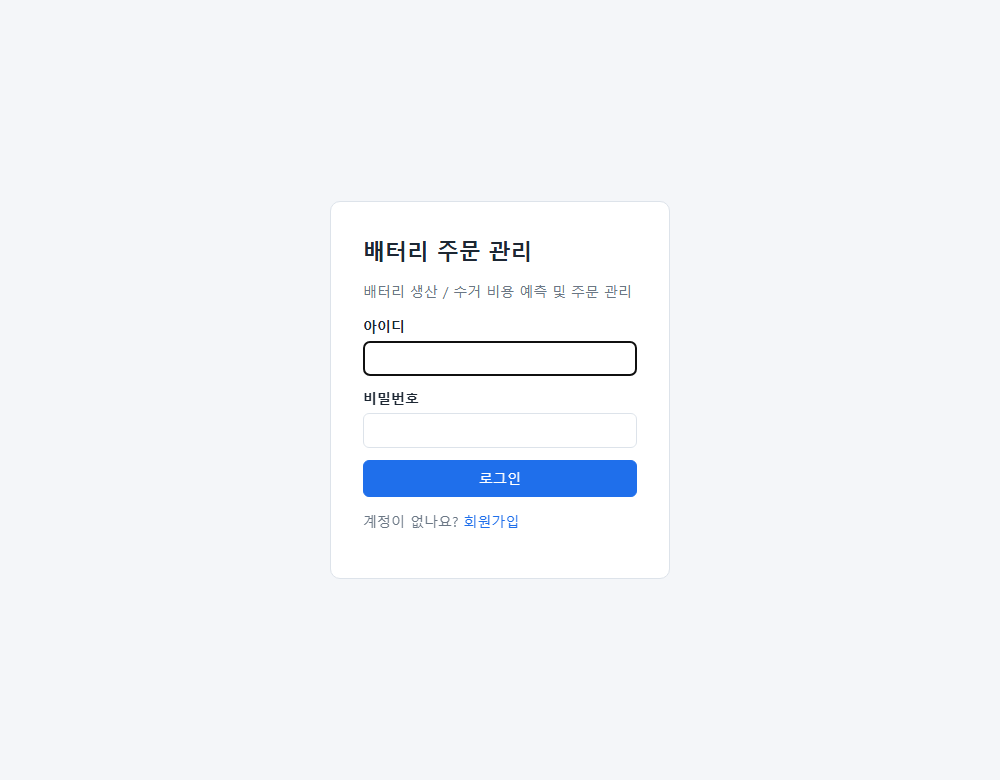
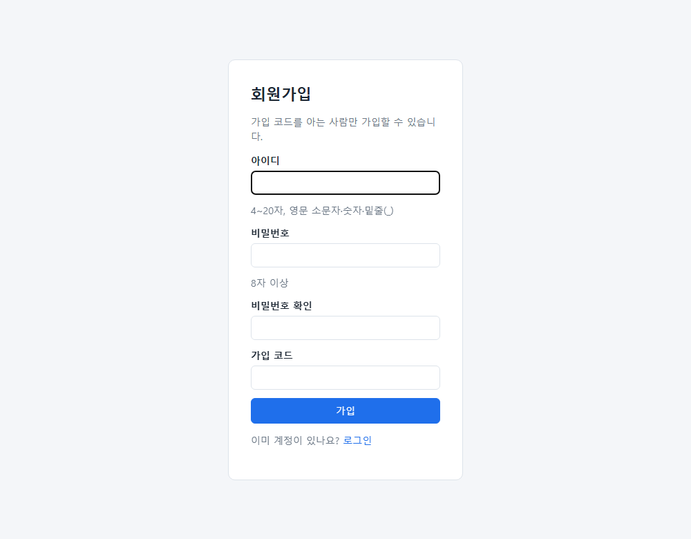
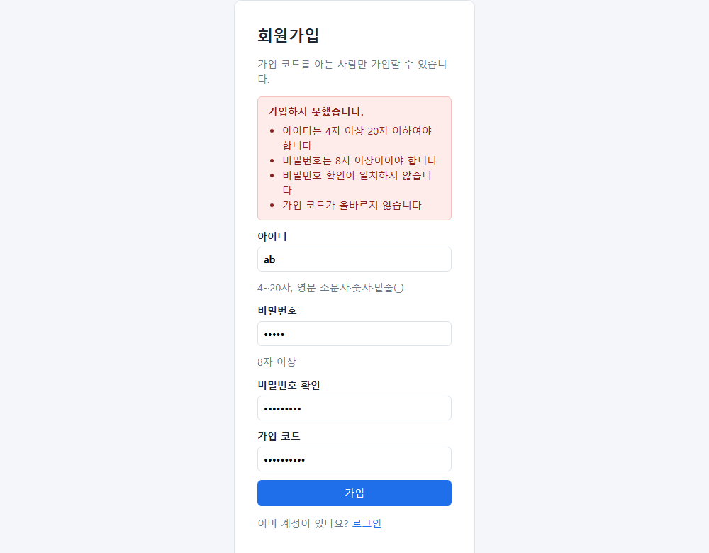
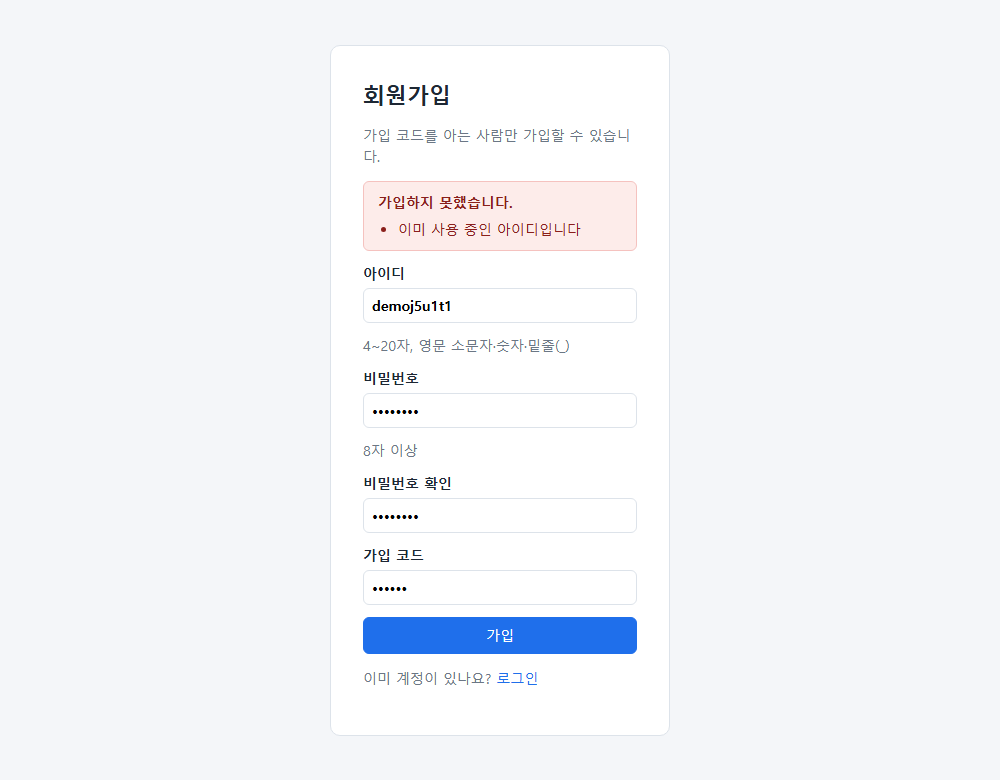
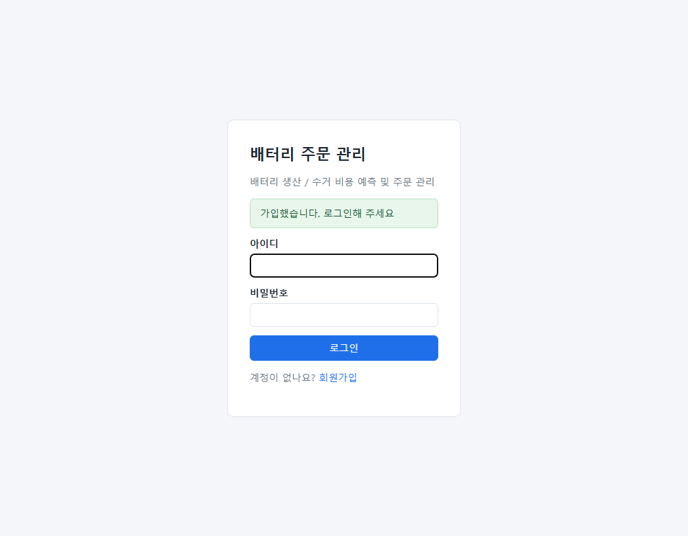
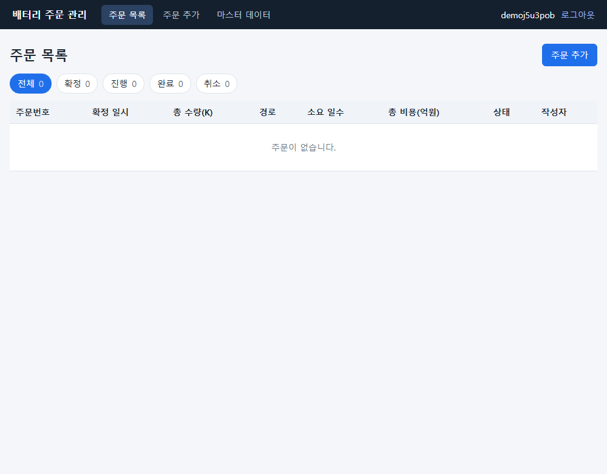

# 회원가입 Evidence

> 이 문서는 **회원가입 기능(PR)** 의 결과를 팀원이 직접 확인할 수 있도록 모은 것입니다. 화면, API 응답, 테스트 결과, 기존 데이터에 대한 영향, 정해 둔 결정을 담았습니다.

## 1. 한눈에 보기

| 항목 | 전 (`main`) | 후 (이 PR) |
|---|---|---|
| 계정 | 하드코딩 1개(`admin/admin`), 비밀번호 평문 비교 | **회원 테이블(`members`)**, 가입 가능, 비밀번호는 BCrypt 해시로만 저장 |
| 권한 | 없음 | 회원마다 **권한 값(`role`) 저장**, 기본 **`ADMIN`(admin과 동일)**. 아직 이 값으로 막는 기능은 없음 |
| 회원가입 | 없음 | 로그인 화면의 링크 → 가입 화면 → `POST /api/signup` |
| 가입 조건 | - | **가입 코드**(서버 설정 `app.signup.code`)를 아는 사람만 |
| 로그인 | 설정의 단일 계정과 비교 | DB 조회 (없는 아이디도 해시 비교 시간을 맞춤) |
| 기존 `admin` | - | 기동 시 자동 생성되어 **그대로 로그인**, 기존 주문의 작성자 `admin` 유효 |
| 단위·통합 테스트 | 92개 통과 | **121개 통과** (실패 0) |
| E2E (Playwright, 인메모리 DB 서버) | 46개 모두 통과 | **56개 모두 통과** (변경 단계마다 연속 실행, 기존 46개 + 회원가입 10개) |

## 2. 정해 둔 결정 (추천 기본안)
| 항목 | 결정 | 이유 |
|---|---|---|
| 가입 조건 | **가입 코드 방식** | 이 앱은 "로그인한 사람만 쓰는" 내부 도구라, 누구나 가입하게 열면 접근 통제(G8)가 사라집니다. |
| 비밀번호 | BCrypt (`spring-security-crypto` 모듈만 추가, Spring Security 전체는 도입하지 않음) | 표준이고 작습니다. |
| 가입 항목 | 아이디, 비밀번호, 비밀번호 확인, 가입 코드 | 화면이 아이디만 보여 주므로 이름·이메일은 쓸 곳이 없습니다. |
| 아이디 | 4~20자, 영문 소문자·숫자·밑줄(_). 앞뒤 공백을 지우고 **소문자로 저장**(대소문자만 달라도 중복) | 혼동과 중복을 막습니다. |
| 비밀번호 규칙 | 8자 이상, **72바이트 이하**(영문·숫자 72자, 한글 24자), 아이디와 같지 않게, 확인 일치 | BCrypt 는 72바이트를 넘으면 예외를 던지므로 글자 수가 아니라 **바이트**로 제한 |
| 기존 `admin` | 기동 시 설정(`app.login.username/password`, 기본 admin/admin)의 아이디가 없으면 자동 생성, 이미 있으면 **비밀번호를 바꾸지 않음** | 기존 주문 이력·테스트·E2E 유지 |
| 가입 후 | **자동 로그인 없음**, 로그인 화면으로 이동해 안내 | 세션 처리가 단순하고 안전 |
| 권한 | 회원마다 `role` 을 저장하고 **모든 회원(가입자와 admin)에게 `ADMIN`** 부여. 권한별로 막는 기능은 만들지 않음 | 담당자/관리자 구분은 PRD §10-6 미결. 값만 두어 나중에 나눌 자리를 마련 |
| 오류 응답 | 입력 오류 400(이유 목록 `errors`), 아이디 중복 **409** | 기존 관례 재사용 (`ApiExceptionHandler`) |
| 로그인 없이 열리는 곳 | `/signup`, `/signup.html`, `/api/signup` 와 기존 로그인 관련 경로뿐 | G8 의 예외로 문서에 명시 |

## 3. 화면
| | |
|---|---|
| **로그인 화면** (회원가입 링크) |  |
| **가입 화면** |  |
| **입력이 틀렸을 때** (서버가 이유를 모두 알리고 입력값은 유지) |  |
| **이미 있는 아이디** |  |
| **가입 후 로그인 화면** (자동 로그인 없음, 안내 표시) |  |
| **가입한 계정으로 로그인한 모습** |  |

## 4. API (실행 중인 서버에서 수집한 실제 응답)
`POST /api/signup` — 성공
```
HTTP 200
{
  "username": "demoj5u4ouc",
  "message": "가입했습니다. 로그인해 주세요"
}
```
입력 오류 (아이디 `ab`, 비밀번호 `short`, 확인 불일치, 가입 코드 틀림)
```
HTTP 400
{
  "error": "아이디는 4자 이상 20자 이하여야 합니다 / 비밀번호는 8자 이상이어야 합니다 / 비밀번호 확인이 일치하지 않습니다 / 가입 코드가 올바르지 않습니다",
  "errors": [
    "아이디는 4자 이상 20자 이하여야 합니다",
    "비밀번호는 8자 이상이어야 합니다",
    "비밀번호 확인이 일치하지 않습니다",
    "가입 코드가 올바르지 않습니다"
  ],
  "conflict": false
}
```
이미 있는 아이디 (앞서 가입한 아이디를 **대문자로 바꿔서** 가입 시도)
```
HTTP 409
{
  "error": "이미 사용 중인 아이디입니다",
  "errors": [
    "이미 사용 중인 아이디입니다"
  ],
  "conflict": true
}
```
`POST /api/login`
```
성공 HTTP 200
{
  "username": "demoj5u4ouc"
}

비밀번호 틀림 HTTP 401
{
  "error": "아이디 또는 비밀번호가 올바르지 않습니다"
}

없는 아이디 HTTP 401
{
  "error": "아이디 또는 비밀번호가 올바르지 않습니다"
}
```
- 틀린 비밀번호와 없는 아이디는 **같은 메시지**를 돌려줘서 어느 쪽이 틀렸는지 알 수 없습니다.
- 가입 응답과 어느 API 응답에도 비밀번호나 해시가 없습니다(`WebBehaviorTest.signupIsPublicAndTheNewMemberCanLogIn`에서 확인).

## 5. 동작이 같다는 근거 / 새로 확인한 것

### 5-1. 단위·통합 테스트 (`./gradlew test`)
| 클래스 | 테스트 수 | 실패 |
|---|---|---|
| `AuthApiControllerTest` | 5 | 0 |
| `DemoApplicationTests` | 1 | 0 |
| `MemberServiceTest` | 20 | 0 |
| `OrderFlowTests` | 9 | 0 |
| `ServiceBehaviorTest` | 31 | 0 |
| `WebBehaviorTest` | 41 | 0 |
| `simulation.PlannerGoldenTest` | 2 | 0 |
| `simulation.PlannerTest` | 12 | 0 |
| **합계** | **121** | **0** |

- 새로 만든 것: `MemberServiceTest`(16), `AuthApiControllerTest`(5, 기존 `AuthApiControllerAccountTest`를 회원 DB 기준으로 바꿈), `WebBehaviorTest`의 가입 시나리오.
- 확인하는 내용: 해시 저장(평문 아님, 같은 비밀번호도 매번 다른 해시), 아이디·비밀번호 규칙과 경계값, 한꺼번에 모은 오류, 대소문자만 다른 중복, **DB 유일 제약**(동시 가입 대비), 가입 코드 오류 시 계정이 만들어지지 않음, 로그인(소문자 정규화, 없는 아이디), **세션 ID 재발급**, 가입 후 자동 로그인이 되지 않음, 가입한 회원이 만든 주문에 그 아이디가 작성자·변경한 사람으로 기록됨.
- 경로 계산·시뮬레이션의 golden 기준 파일은 **바꾸지 않았고** 그대로 통과합니다.

### 5-2. E2E (Playwright)
| 실행 | 코드 | 테스트 수 | 통과 | 실패 | 소요 | 실패한 시나리오 |
|---|---|---|---|---|---|---|
| 전 1 | main | 46개 | 46 | 0 | 62초 | - |
| 전 2 | main | 46개 | 46 | 0 | 60초 | - |
| 전 3 | main | 46개 | 46 | 0 | 60초 | - |
| 후 1 | 이 PR (권한 추가 전) | 53개 | 53 | 0 | 70초 | - |
| 후 2 | 이 PR (권한 추가 전) | 53개 | 53 | 0 | 71초 | - |
| 후 3 | 이 PR (권한 추가 전) | 53개 | 53 | 0 | 70초 | - |
| 후 4 | 이 PR (권한 추가 후) | 53개 | 53 | 0 | 78초 | - |
| 후 5 | 이 PR (권한 추가 후) | 53개 | 53 | 0 | 80초 | - |
| 후 6 | **이 PR (버그 수정·정리 후, 최종)** | 56개 | 56 | 0 | 72초 | - |
| 후 7 | **이 PR (버그 수정·정리 후, 최종)** | 56개 | 56 | 0 | 77초 | - |
| 후 8 | **이 PR (버그 수정·정리 후, 최종)** | 56개 | 56 | 0 | 76초 | - |

회원가입 시나리오 10개:

| 시나리오 | 결과 | 시간 |
|---|---|---|
| G1 가입 → 로그인 → 주문 목록 | 통과 | 1.0초 |
| G2 입력이 틀리면 이유를 모두 알리고 입력한 값은 그대로 둔다 | 통과 | 0.8초 |
| G3 이미 있는 아이디는 거절한다 (대소문자만 달라도) | 통과 | 1.0초 |
| G4 가입 코드가 틀리면 거절하고 계정이 만들어지지 않는다 | 통과 | 0.7초 |
| G5 이미 로그인한 사람이 가입 화면을 열면 주문 목록으로 보낸다 | 통과 | 0.7초 |
| G6 가입한 회원이 만든 주문에는 그 회원의 아이디가 남는다 | 통과 | 2.1초 |
| G7 기존 admin 계정은 그대로 로그인된다 | 통과 | 0.6초 |
| G8 서버에 연결할 수 없으면 가입 화면이 안내를 보여 준다 | 통과 | 0.4초 |
| G9 서버에 연결할 수 없으면 로그인 화면도 같은 안내를 보여 준다 | 통과 | 0.4초 |
| G10 한글로 된 긴 비밀번호는 서버 오류가 아니라 안내로 거절한다 | 통과 | 1.0초 |

- 가입한 계정은 지울 수 없어 실행할 때마다 쌓이므로 테스트는 매번 새 아이디를 만들고, 인메모리 DB 서버에서 실행합니다(`playwright.config.ts` 설명 참고).
- 기존 46개는 그대로 통과합니다(`admin/admin` 로그인이 계속 되기 때문).

### 5-2-1. 점검 중 발견해 고친 버그: 긴 한글 비밀번호가 서버 오류(500)로 실패
- **현상:** BCrypt 는 비밀번호가 72바이트를 넘으면 `IllegalArgumentException`을 던집니다. 처음 검증은 "50자 이하"라서, **한글 25자 이상**(한 글자 3바이트)은 검증을 통과한 뒤 가입 단계에서 서버 오류가 났습니다.
- **확인:** 임시 테스트로 재현했습니다(영문 73바이트와 한글 30자는 예외, 영문 72바이트는 통과, 로그인 쪽 비교는 예외 없음).
- **수정:** 글자 수가 아니라 **바이트 수(72 이하)** 로 검증하고, "비밀번호가 너무 깁니다. 영문·숫자는 72자, 한글은 24자까지 쓸 수 있습니다"로 안내합니다. 가입 화면의 안내와 입력 제한(72자)도 맞췄습니다.
- **테스트:** `passwordLengthIsCheckedInBytesNotCharacters`(한글 25·30자 거절, 영문 69자+한글 1자·한글 24자 경계 통과), `veryLongPasswordCannotLogInButDoesNotCrash`, E2E G10.

### 5-2-2. 로그인 상태 판단과 `/api/me` 정리
- **전:** `/api/me`가 화면을 열 때마다 DB 에서 권한을 조회했고, 회원이 DB 에 없으면 `ADMIN`으로 대신 응답해 이상 상태를 가렸습니다.
- **후:** 로그인할 때 권한을 **세션에 함께 저장**하고 `/api/me`는 세션 값만 돌려줍니다(DB 조회 없음). **아이디와 권한이 모두 세션에 있어야 로그인 상태**로 보며, 한쪽이라도 없으면 로그인하지 않은 것으로 보고 다시 로그인하게 합니다. 로그인 판단은 `LoginInterceptor.isLoggedIn` 한 곳에서 하고 `/login`, `/signup` 라우트도 같은 함수를 씁니다(판단이 어긋나 로그인 화면과 주문 목록을 오가는 일을 막음).
- **테스트:** `sessionWithoutRoleIsTreatedAsLoggedOutWithoutRedirectLoops`(권한 없는 세션은 `/orders`→`/login`, `/login`·`/signup`은 열림, API 401), `meReturnsTheRoleStoredInTheSession`, `AuthApiControllerTest`(세션에 `ADMIN` 저장, 실패 시 저장 안 됨).

### 5-2-3. 화면 코드 정리
- 서버에 연결하지 못했을 때의 안내를 `common.js` 의 `requestJson` 한 곳에서 만듭니다(`NETWORK_ERROR_MESSAGE`, `err.network`). 로그인 화면도 같은 함수를 쓰게 해(`redirectOn401: false` 옵션) 직접 `fetch` 하던 중복을 없앴습니다.
- "제목 + 이유 목록" 오류 상자를 `errorListAlert` 한 곳으로 모아 마스터 저장과 회원가입이 같은 코드를 씁니다.
- E2E G8·G9: 서버 연결 실패 시 가입 화면과 로그인 화면이 같은 안내를 보여 줍니다.

### 5-3. 권한 (`role`)
- `Role` enum(지금은 `ADMIN`("관리자") 하나)을 두고 `Member.role` 열에 저장합니다. 가입할 때(`MemberService.DEFAULT_ROLE`)와 처음 만드는 `admin`에 모두 `ADMIN`을 줍니다.
- **권한으로 막는 기능은 없습니다.** 모든 회원이 지금과 똑같이 모든 기능을 씁니다. 나중에 권한을 나눌 때는 `Role`에 값을 더하고, 접근을 막는 곳(`LoginInterceptor` 나 서비스)에서 이 값을 보면 됩니다.
- 로그인한 사용자 확인 `GET /api/me` 응답에 `role`이 추가되었습니다: `{"role":"ADMIN","username":"admin"}` (로그인할 때 세션에 담은 값을 그대로 돌려주며, 화면이 나중에 쓸 수 있도록 알려 주기만 함)
- **권한 열이 없던 시절에 만든 행도 `ADMIN`입니다.** 열 정의에 DB 기본값(`default 'ADMIN' not null`)을 두어, 권한이 생기기 전에 가입한 회원(복사본의 `admin`, `migrated1`)이 새 코드에서도 `ADMIN`으로 로그인·조회됨을 확인했습니다(아래 5-4).
- 테스트: `MemberServiceTest.signedUpMemberGetsTheSameRoleAsAdmin`, `everyMemberInTheDatabaseHasARole`, `WebBehaviorTest.loginSetsSessionAndMeReturnsTheUser`(`role`=ADMIN).

### 5-4. 기존 파일 DB에서의 동작 (복사본으로 확인)
기존에 쓰던 `data/battery`(주문 2건: 완료 1, 취소 1)의 **복사본**으로 서버를 띄웠습니다(원본은 건드리지 않음).
- `members` 테이블이 자동 생성되고(`ddl-auto=update`), `admin`이 시드되어 **`admin/admin`으로 로그인됩니다.**
- 기존 주문 2건이 그대로 보이고 작성자는 `admin`입니다.
- 같은 서버에서 가입 → 로그인도 정상입니다.
- 이어서 **권한을 추가한 새 코드로 같은 복사본(권한 열이 없던 `members` 행 포함)을 다시 띄웠을 때**: 열이 추가되고 `admin`, `migrated1` 모두 `{"role":"ADMIN"}`로 로그인되며 새 가입자도 `ADMIN`입니다. 오류 로그는 없었습니다.

## 6. 달라진 점 (동작이 바뀌는 것)
1. **로그인이 DB 기준이 됩니다.** 설정 `app.login.username/password`는 "처음 만들 계정의 값"이 되고, **이미 만들어진 뒤에는 설정을 바꿔도 비밀번호가 바뀌지 않습니다**(비밀번호 변경 기능은 아직 없음).
2. **아이디는 소문자로 저장·비교됩니다.** `Admin`으로 로그인해도 `admin`으로 처리됩니다.
3. **로그인 없이 열리는 곳이 늘었습니다**: 가입 화면과 가입 API(가입 코드로 보호).
4. `GET /api/me` 응답에 `role`이 추가되었습니다(기존 `username`은 그대로). 권한은 로그인할 때 세션에 담기므로 **권한이 바뀌면 다시 로그인해야 반영**되고, **권한이 없는 옛 세션은 다시 로그인**해야 합니다.
4-1. **비밀번호 길이 한도가 글자 수(50자)에서 바이트 수(72바이트)로 바뀝니다.** 영문·숫자는 72자까지, 한글은 24자까지입니다.
4-2. 서버에 연결할 수 없을 때의 안내가 모든 화면에서 같은 문구입니다.
5. 기동 로그에 경고가 최대 2줄 나올 수 있습니다: 가입 코드가 기본값(`signup`)일 때, 계정이 기본값(`admin/admin`)일 때.

## 7. ⚠️ 운영 전에 반드시 설정할 것
- **`app.signup.code`**: 기본값 `signup`은 누구나 알 수 있습니다. 운영에서는 반드시 바꿔야 합니다(기본값이면 기동 로그에 경고).
- **`app.login.username` / `app.login.password`**: 기본 `admin/admin`입니다. 처음 기동하기 전에 바꾸세요. 이미 기동한 DB의 admin 비밀번호는 설정으로 바뀌지 않습니다.

## 8. 이 PR이 하지 않은 것 (후속)
- 권한(`role`)에 따라 기능을 **제한하는 것**과 담당자·관리자 구분(PRD §10-6, 값만 저장하고 적용은 하지 않음), 코드 대신 **관리자 승인** 방식
- 비밀번호 변경·재설정, 이메일 인증, **로그인·가입 시도 횟수 제한**(가입 코드를 무차별 대입할 수 있음), 계정 삭제·잠금, 회원 목록
- 가입한 계정이 **다른 사람의 주문을 보거나 바꾸는 것**은 막지 않습니다(전에도 로그인한 사람은 모든 주문을 볼 수 있었음).

## 9. 직접 재현하기
리팩토링 1 Evidence(`docs/evidence/sy9169/refactoring-1/README.md`)의 5번 순서와 같습니다.
- 단위·통합: `.\gradlew.bat test` → 121개 통과.
- E2E: 서버를 새로 띄우고(`--spring.datasource.url=jdbc:h2:mem:e2e;DB_CLOSE_DELAY=-1`) `npx playwright test` → **56 passed**. 가입 코드를 바꿔 띄웠다면 `SIGNUP_CODE` 환경변수로 알려 줍니다.
- 화면: `.\gradlew.bat bootRun` 후 `http://localhost:8080/login` → "회원가입" (가입 코드 기본값 `signup`).
