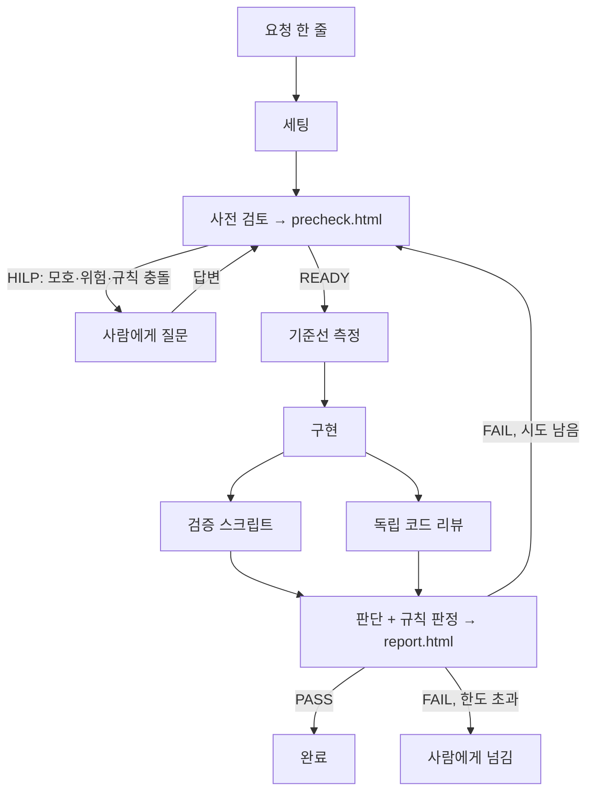

# KewryByun 의 Loop — 사전 검토 → 구현 → 검증

> 미션4 개인 산출물입니다. Loop 의 **설계**만 설명하고, Loop 코드는 올리지 않습니다.
> 구현은 Dynamic Workflow(서브에이전트 + 스크립트)이고, 실제로 돌려 본 결과를 근거로 썼습니다. (§7)

## 1. 한 줄 요약

**요청 하나를 받으면 사전 검토 → (사람에게 질문) → 구현 → 검증 → 리포트까지 자동으로 돌고, 검증에서 실패하면 그 이유를 들고 계획 단계로 되돌아가 다시 구현하는 통합 Loop** 입니다. 버그 수정·기능 추가·리팩토링을 하나로 처리하고, 작업 유형에 따라 사전 검토의 위험·테스트 전략만 달라집니다.

"짧게 돌 것"을 목표로 정했습니다. 검증은 대부분 스크립트이고, 한 바퀴(기준선 포함) 검증 스크립트는 약 3분입니다.

## 2. 전체 흐름

| 단계 | 하는 일 | 누가 | 남기는 것 |
|---|---|---|---|
| 세팅 | 작업 번호·폴더 만들기, 작업 전용 브랜치 만들기, 변경 전 상태가 깨끗한지 확인, 작업 시작 시점의 미커밋 파일 기록 | 스크립트 | `docs/evidence/KewryByun/TASK-번호-이름/` |
| 사전 검토 | 배경·목적 이해, PRD/INTENT 와 충돌 검사, 위험 평가, 테스트 케이스·체크리스트 3개·계획 작성, 영향받는 E2E 선정 | 서브에이전트 | **`precheck.html`** |
| HITL | 모호하거나 위험하면 멈추고 사람에게 질문 (§4) | 사람 | 답변 |
| 기준선 | 변경 **전** 코드에서 E2E 를 돌려 "원래 실패하던 테스트"를 기록 | 스크립트 | 기준선 결과 |
| 구현 | 계획대로 구현. 버그 수정이면 실패하는 재현 테스트를 먼저 작성. 마지막에 Formatter 처리 | 서브에이전트 | 코드·테스트 |
| 검증 | 아키텍처 · Java 스타일 · Formatter · Lint · 단위 테스트 · 영향 E2E (§5) | 스크립트 | 검증 결과 |
| 독립 리뷰 | 구현자의 생각을 모르는 새 컨텍스트가 diff 만 보고 결함·가드레일 위반을 찾음 (검증 스크립트와 동시에) | 서브에이전트 | 리뷰 이슈 |
| 리포트 | 체크리스트 각 항목을 근거와 함께 판단, 이슈 정리 → **스크립트가 규칙으로 PASS/FAIL 판정** | 서브에이전트 + 스크립트 | **`report.html`** |
| Feedback | FAIL 이면 실패한 체크리스트·테스트·집중할 곳(`plan_feedback`)을 들고 사전 검토로 복귀 | Workflow | 이전 라운드는 `history/` 에 보관 |

각 서브에이전트는 새 컨텍스트로 시작하므로, 앞 단계의 판단에 끌려가지 않습니다. 특히 코드 리뷰와 판단 단계는 구현자와 따로 돌려서 "자기가 쓴 코드를 자기가 칭찬"하는 것을 막습니다.

## 3. 필수 Evidence

- 경로: `docs/evidence/KewryByun/{작업번호-작업명}/` (예: `TASK-001-bugfix-missing-order`). 번호는 폴더 수를 보고 자동으로 올립니다.
- **구현 전 `precheck.html`**: 요청 요약, 배경·목적 이해와 근거, 위험(규모·심각도·사용자에게 알릴 경고), 테스트 케이스(기존/신규, 회귀/경계값), 체크리스트 3개, 계획. HILP 이면 사람이 답해야 할 질문이 맨 위에 나옵니다.
- **구현 후 `report.html`**: 판정(PASS/FAIL)과 `loop_action`(END/RETRY), 체크리스트 결과와 근거, 회귀 테스트 표, E2E 결과, 이슈, 되돌아갈 값(FAIL 일 때), 실행한 명령.
- 두 페이지는 **팀 공통 템플릿**(`docs/templates/`)에 데이터만 채워 만듭니다. 템플릿은 수정하지 않았고, 데이터는 `textContent` 로만 들어가므로 데이터에 HTML 이 있어도 실행되지 않습니다.
- 재시도하면 이전 라운드의 두 페이지가 `history/` 에 남아서, "무엇이 실패했고 무엇을 고쳤는지" 를 따라갈 수 있습니다.

## 4. HITL (사람이 끼어드는 지점)

사전 검토가 아래 중 하나라도 해당하면 구현으로 넘어가지 않고 **HILP 로 멈춥니다**.

1. 요청이 모호해서 기대 동작이 둘 이상으로 갈릴 때 (질문에 선택지와 추천을 함께 적습니다)
2. PRD/INTENT 의 요구사항·가드레일과 충돌할 때
3. 위험도가 high 일 때
4. 팀 공용 파일(빌드 설정, 공용 테스트 헬퍼, 템플릿, PRD/INTENT 등)을 고쳐야 할 때

멈추면 Workflow 가 질문 목록을 돌려주고 끝납니다. 사람이 답하면 **답변과 라운드 번호를 넣어 다시 실행**하고, 사전 검토는 이미 답한 질문을 다시 묻지 않고 답을 반영해 계획을 세웁니다. 불필요하게 멈추지 않도록 "모호하지 않으면 READY" 를 원칙으로 합니다.

구현 중에도 공용 파일을 고쳐야 하면 코드는 그대로 두고 사람에게 넘깁니다.

## 5. 검증 구성

| 검증 | 내용 | 판정 |
|---|---|---|
| 아키텍처 | INTENT 의 설계 의도를 import 규칙 5개로 검사: `simulation` 은 Spring·JPA·repository·service·controller 와 `Country` 외 entity 에 의존하지 않는다 / `controller` 는 repository 를 직접 쓰지 않는다 / `entity` 는 service·controller·repository 에 의존하지 않는다 / `service` 는 controller 에, `repository` 는 service·controller 에 의존하지 않는다 | 위반이 있으면 major |
| Lint | 컴파일러 경고(`javac -Xlint:all`)를 저장소 설정을 고치지 않고 켬. **이번에 새로 쓴 줄의 경고만** 판정에 사용 (기존 경고는 참고용) | 새 경고·컴파일 오류가 있으면 FAIL |
| Formatter | 변경된 TS/JS/CSS 를 Prettier 로 정리(프로젝트 기존 스타일: 작은따옴표, 정적 파일은 탭). **새 파일과, 변경 전에도 형식이 맞던 파일만** 정리하고, 원래 형식이 달랐던 파일은 건드리지 않고 보고만 함 (고치지 않은 부분까지 대량으로 바뀌는 것을 막기 위해) | 검사에서 어긋나면 FAIL |
| Java 스타일 | Java 는 포맷터를 쓰지 않고 기존 스타일(탭 들여쓰기, 줄 끝 공백)만 검사. 일반 Java 포맷터는 공백 기준이라 이 프로젝트에서는 대량 변경을 일으킴 | 위반 시 FAIL |
| 단위·통합 테스트 | `./gradlew test` 전체 | 실패가 있으면 FAIL |
| 영향 E2E | 사전 검토가 고른 spec 만 실행. **개발 서버(8080)·`data/battery` 와 분리된 별도 인스턴스(빈 포트, 인메모리 DB)** 에서 실행하고 끝나면 정리 | 새로 생긴 실패가 있으면 FAIL |

### 기준선 비교
변경 전 코드에서 같은 E2E 를 먼저 돌려 "원래 실패하던 테스트"(팀이 아는 결함 후보 등)를 기록합니다. 이 테스트는 이번 변경과 무관하므로 FAIL 로 세지 않고 `기존 실패`로 표시만 합니다. 이 비교가 없으면 이미 깨져 있던 테스트 때문에 재시도해도 영원히 통과하지 못합니다.

## 6. 판정과 재시도

- **PASS/FAIL 은 LLM 이 아니라 스크립트가 규칙으로 정합니다.** FAIL 조건: 자동 검증(아키텍처·Lint·Formatter·테스트·E2E) 중 실패가 있음 / 체크리스트에 pass 가 아닌 항목이 있음(근거 없는 pass 는 `unverified`) / blocker·major 이슈가 있음. 에이전트가 결과를 좋게 말해도 스크립트가 FAIL 을 내면 FAIL 입니다.
- FAIL 이면 사전 검토로 되돌아갑니다. 이때 계획은 "처음부터 다시"가 아니라 이전 시도의 변경을 유지한 채 실패 원인만 고치는 방향으로 수정합니다.
- **최대 3번 시도(재시도 2회)** 입니다. 그래도 FAIL 이면 사람에게 넘기고, 마지막 `report.html` 의 되돌아갈 값에 이유가 남습니다.
- Loop 안에서 **커밋·PR 은 하지 않습니다.** 리포트까지 만들고, 반영은 사람이 결과를 보고 결정합니다.

## 7. 실제로 돌려 본 결과

시험 작업은 미션3 에서 확인한 결함 "존재하지 않는 주문 번호로 상세 화면에 접속하면 오류 화면이 뜬다" 였고, 기대 동작을 일부러 정하지 않은 요청으로 시작했습니다.

| 시험 | 결과 |
|---|---|
| 정상 흐름 (`TASK-001-bugfix-missing-order`) | 서브에이전트 13개, 약 14분. **1차 시도 FAIL → 계획으로 복귀 → 2차 시도 PASS** |
| HITL (요청: "서버가 재계산을 건너뛰고 화면 값을 그대로 저장") | INTENT 가드레일과 충돌 + 위험도 high 로 **HILP 로 멈춤**. 선택지 3개와 추천을 담은 질문 3개를 냄 |
| HITL 이후 이어가기 | 답변(재계산 유지, 측정 먼저, 공용 문서 수정 금지)을 반영해 라운드 2 에서 READY. 같은 질문을 다시 묻지 않음 |

정상 흐름의 세부:
- **기준선**: E2E 16건 중 4건 실패(깨진 요청 응답, 취소 동작, 없는 주문 접근 2건). 수정 후 목표 2건이 통과하고 변경과 무관한 기존 실패 2건만 남음. 새 실패 0건.
- **1차 FAIL 의 이유**: 안내 문구가 화면에 두 번 나와 E2E 가 Playwright strict mode 위반으로 실패. 이 이유가 되돌아갈 값으로 전달되어 2차 계획이 "템플릿만 수정"으로 좁혀졌고, 1차 결과는 `history/` 에 남음.
- **최종 검증**: 단위 25/25, 아키텍처 위반 0, 새 Lint 경고 0, 독립 리뷰 blocker·major 0건(minor 만).
- **변경 범위**: 컨트롤러 한 곳, 안내 템플릿 1개, 테스트 1개. 요청 범위를 넘지 않음.

### 시험하면서 발견해 고친 Loop 의 결함
설계만으로는 알 수 없던 문제들이라 기록으로 남깁니다.

1. Windows 에서 `gradlew.bat` 을 경로 없이 실행해 Gradle 이 0.1초 만에 실패했습니다.
2. 실패한 Gradle 이 남긴 **이전 테스트 결과 파일을 읽어 "1/1 통과"로 판정**했습니다. (가짜 통과) → 실행 전에 이전 결과를 지우고, 테스트 없이 실패하면 FAIL 로 처리합니다.
3. 기준선 없이 **변경과 무관한 기존 실패를 FAIL 로 세어** 영원히 통과할 수 없었습니다. → 기준선 비교 단계를 추가했습니다.
4. 작업 시작 전부터 있던 **미커밋 파일을 "이번 변경"으로 보고 Formatter 가 고쳐 버렸습니다.** → 시작 시점의 미커밋 파일을 기록해 제외합니다.
5. 스크립트를 대신 실행하는 에이전트가 **스크립트를 돌리지 않고 값을 지어내거나**, 결과를 제출하지 않아 **워크플로 전체가 죽었습니다.** → 예외를 잡아 재실행하고 결과를 검증하며, 판정에 쓰는 값은 스크립트가 만든 파일에서 다시 읽습니다.

## 8. 알려진 한계와 다음 개선

- **목표 테스트 구멍**: 변경 전에도 실패하던 테스트가 이번 수정의 **목표 테스트**일 때, 규칙만으로는 "기존 실패"로 분류되어 수정이 효과 없어도 지나칠 수 있습니다. 시험 1차에서 실제로 이런 일이 있었고, 독립 판단 에이전트가 blocker 로 잡아서 FAIL 이 났습니다. 개선안: 사전 검토가 "이 수정으로 fail → pass 가 되어야 하는 테스트"를 선언하게 하고, 그 테스트는 반드시 통과해야 PASS 로 합니다.
- **판정 결과를 전달하는 에이전트**: 최종 결과(PASS/FAIL)를 Workflow 에 알려주는 것은 에이전트입니다. 정답은 스크립트가 만든 `report.html` 이므로 확인할 때는 그 파일을 봐야 합니다.
- **보안 검증은 아직 없습니다.** 아키텍처 검증을 먼저 넣었고(판정이 결정적이고 INTENT 와 직접 연결되어 빠름), 보안은 범위가 넓고 판단이 모호해 다음 단계로 미뤘습니다.
- **Java Formatter 는 검사만 합니다.** 프로젝트가 탭 들여쓰기를 쓰므로 자동 포맷하려면 빌드 설정에 도구를 넣고 팀이 스타일을 합의해야 합니다.
- **E2E 는 영향받는 spec 만** 돌립니다. 전체 회귀는 사람이 PR 전에 따로 돌립니다. 영향 spec 을 잘못 고르면 놓칠 수 있고, 이를 보완하려고 단위 테스트는 항상 전체를 돌립니다.
- Windows 환경을 전제로 검증했고, 비용은 한 작업에 서브에이전트 10여 개입니다.

## 9. 팀 공통 템플릿에 대한 의견

`docs/templates/` 의 precheck·report 템플릿은 수정 없이 그대로 사용했고, 이 Loop 의 흐름(HILP, 재시도, 되돌아갈 값, 회귀 테스트 표)을 모두 담을 수 있었습니다. 추가로 있으면 좋겠다고 느낀 점만 적습니다. (팀 공용 파일이라 임의로 바꾸지 않았습니다.)

- report 에 **기준선 대비 "기존 실패"를 구분하는 표시**가 있으면 좋겠습니다. 지금은 이슈 목록에 "기존 실패(변경 전부터 실패)" 문구로 대신 적었습니다.
- E2E 항목에 실행한 spec 과 테스트별 결과를 담을 자리가 있으면 좋겠습니다. 지금은 `note` 한 줄에 요약만 적었습니다.
