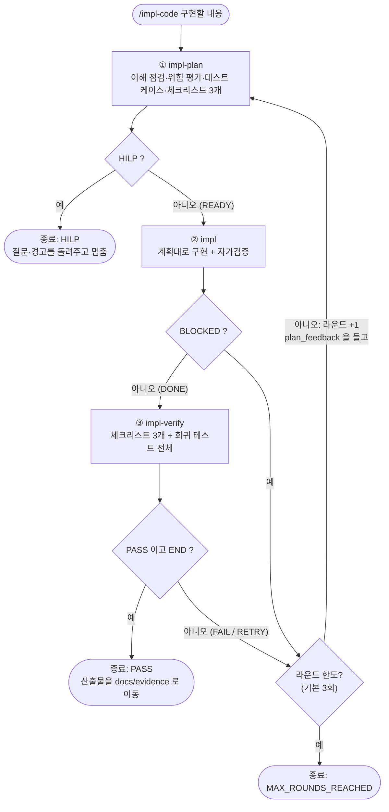

# impl-code 루프 설계

`/impl-code` 는 **계획 → 구현 → 검증**을 자동으로 반복하는 구현 하네스(Implement Harness)다.
검증이 실패하면 구현이 아니라 **계획 단계로 되돌아가** 실패 원인을 해결하는 수정 계획을 다시 세우고,
계획 단계가 **사람의 판단이 필요하다(HILP)** 고 하면 루프를 끝낸다.

- 작성자: SangwooSong (산출물 경로의 `SangwooSong` 폴더는 이 이름을 따른다)
- 기준: `main` + 이 브랜치의 `.claude/workflows/impl-code.js` 와 `.claude/agents/impl_*.md`

## 1. 왜 이렇게 만들었나

| 문제 | 설계 |
|---|---|
| 요구사항을 이해하지 못한 채 구현부터 시작한다 | 계획 단계가 **배경·목적을 이해했는지 먼저 점검**하고, 못 했으면 구현하지 않고 HILP 로 묻는다 |
| 사용자가 모르는 큰 변경·높은 위험이 있다 | 규모가 크거나 위험이 높은데 사용자가 알고 있다는 표시가 없으면 **경고와 함께 HILP** |
| 구현한 사람이 자기 결과를 스스로 "통과"라고 한다 | **구현과 검증을 분리**한다. 검증 담당은 구현 보고를 믿지 않고 직접 확인한 사실만 보고한다 |
| 검증이 실패했을 때 구현만 계속 덧댄다 | 실패 원인이 **계획에 있었는지 구현에 있었는지**부터 판단하도록 **계획 단계로** 되돌린다 |
| 무한히 반복한다 | 라운드 한도(기본 3회). 한도에 닿으면 조용히 성공 처리하지 않고 그대로 보고한다 |
| 무엇을 했는지 남지 않는다 | 계획 점검과 검증 리포트를 HTML 로 남기고, 통과하면 `docs/evidence/` 로 옮긴다 |

## 2. 구성 요소와 위치

| 구성 | 파일 | 역할 |
|---|---|---|
| 워크플로 | `.claude/workflows/impl-code.js` | 흐름 제어(분기·반복·종료). `/impl-code` |
| 계획 에이전트 | `.claude/agents/impl_plan.md` (`impl-plan`) | 이해 점검, 위험 평가, 테스트 케이스, 체크리스트, 점검 페이지 |
| 구현 에이전트 | `.claude/agents/impl.md` (`impl`) | 계획대로 구현 + 자가검증 |
| 검증 에이전트 | `.claude/agents/impl_verify.md` (`impl-verify`) | 체크리스트 확인, 회귀 테스트 전체 실행, 리포트, 산출물 이동 |
| HTML 템플릿 | `docs/templates/precheck.template.html`, `report.template.html` | 점검 페이지·리포트의 틀 (사용법: `docs/templates/README.md`) |

> `.claude/` 는 `.gitignore` 대상이라 **워크플로와 에이전트 정의는 저장소에 올라가지 않는다**(개인 환경에만 있다).
> 이 문서와 `docs/templates/`, `docs/evidence/` 만 공유된다. 같은 방식으로 쓰려면 위 파일들을 각자 `.claude/` 아래에 두고,
> 에이전트 정의 안의 산출물 경로(`.../SangwooSong/`)를 자기 폴더 이름으로 바꾼다.

## 3. 실행 방법

```
/impl-code 구현할 내용
```

인자는 문자열이거나 `{request, maxRounds?}` 이다. 구현할 내용은 **배경, 목적, 요구사항, 제약**을 함께 적을수록 좋다.
계획 단계가 배경·목적을 이해했다고 판단할 근거가 되고, 사용자가 위험을 알고 있다는 표시도 여기서 읽는다.

```
/impl-code
주문 취소 시 주문을 삭제하지 않고 CANCELED 상태로 보존하고, 취소 사유를 저장·조회할 수 있게 한다.
[배경] 현재는 취소하면 주문이 삭제되어 상세가 오류 화면이 되고 '취소' 칩이 항상 0이다.
[목적] 취소한 주문도 기록으로 남겨 조회하고, 왜 취소했는지 추적한다.
[요구사항] 1. ... 2. ...
[제약] 확정 스냅샷은 바꾸지 않는다. 데이터 삭제 동작을 바꾸는 큰 변경임을 알고 요청한다.
```

## 4. 흐름



### 단계별 설명

1. **① 계획 (`impl-plan`)** — 코드를 수정하지 않고 읽기만 한다.
   - 배경·목적을 이해했는지 근거(요청문 인용, `파일:줄`, 문서 절)와 함께 판단한다. 못 했으면 `HILP`.
   - 변경 규모(`small/medium/large`)와 위험도(`low/medium/high`)를 평가한다. 큰 변경·높은 위험인데 사용자가 모르는 것으로 보이면 **경고와 함께 `HILP`**. 요청문에 인지했다는 표시가 있으면(`userAware`) 경고만 남기고 진행한다.
   - 수정되는 동작마다 기존 테스트를 찾고, 없으면 테스트 케이스를 **명세로** 쓴다(회귀·경계값 포함). 실제 테스트 코드는 `impl` 이 이 명세대로 만든다.
   - 구현 후 꼭 확인할 **체크리스트 3개**를 고른다.
   - 점검 결과 페이지 `precheck.html` 을 만든다(READY·HILP 모두).
2. **② 구현 (`impl`)** — 계획과 테스트 케이스 명세대로 구현하고, 끝내기 전에 자가검증(빌드·테스트, 계획 대조, `git diff` 점검)을 한다. 계획이 코드와 맞지 않으면 추측하지 않고 `BLOCKED` 로 보고한다. 커밋·push 는 하지 않는다.
3. **③ 검증 (`impl-verify`)** — 소스를 고치지 않는다.
   - 계획 단계의 체크리스트 3개를 하나씩 직접 확인한다(`pass/fail/unverified`).
   - 회귀 테스트를 모두 실행한다: JUnit 은 `./gradlew cleanTest test`, Playwright E2E 는 `src/test/e2e` 에 스펙이 있고 **이미 실행 중인 서버**가 응답할 때만 실행한다(서버를 직접 띄우지 않으며, 서버가 없으면 실패가 아니라 "건너뜀").
   - 체크리스트 3개가 모두 `pass` 이고 실행한 회귀 테스트가 전부 통과해야 `PASS`/`END`. 아니면 `FAIL`/`RETRY` 와 `plan_feedback` 을 돌려준다.
   - 항상 `report.html` 을 만들고, PASS 이면 산출물을 옮긴다(7절).

## 5. 에이전트 계약 (입출력)

| 에이전트 | 도구 | 주요 반환 |
|---|---|---|
| `impl-plan` | Read, Write, Glob, Grep | `status`(`READY`/`HILP`), 이해 점검(`background`, `purpose`), `risk`(규모·위험도·`userAware`·`warning`), `test_cases`, `post_checklist`(3개), `plan`·`completion_criteria`(READY), `questions`·`reason`(HILP), `precheck_html` |
| `impl` | Read, Write, Edit, Glob, Grep, Bash | `status`(`DONE`/`BLOCKED`), `summary`, `changed_files`, `self_check`, `deviations`, `open_issues` |
| `impl-verify` | Read, Write, Glob, Grep, Bash | `verdict`(`PASS`/`FAIL`), `loop_action`(`END`/`RETRY`), `checklist`, `regression`(전체·통과·실패·건너뜀), `issues`, `plan_feedback`(FAIL), `report_html`, `precheck_html`·`work_no`(PASS) |

워크플로는 각 에이전트에게 **JSON 스키마**를 지정해 구조화된 값으로 받는다. 값의 이름과 허용값이 곧 계약이다.

## 6. 루프 제어

| 상황 | 동작 |
|---|---|
| 계획 `status = HILP` | 즉시 종료. `questions`·`reason`·`warning`·`precheck_html` 반환 |
| 구현 `status = BLOCKED` | 검증을 건너뛰고, 막힌 이유를 `plan_feedback` 으로 만들어 **계획으로 되돌아감** |
| 검증 `PASS` **이고** `loop_action = END` | 종료(`PASS`) |
| 검증 `FAIL`/`RETRY` | `plan_feedback`·`issues` 를 들고 **계획으로 되돌아감**. 다음 계획은 통과한 부분을 다시 바꾸지 않는 **수정 계획** |
| `verdict = PASS` 인데 `loop_action ≠ END` (값이 어긋남) | **통과로 인정하지 않고** 계획으로 되돌아감 |
| 라운드가 한도(기본 3, `{request, maxRounds}` 로 변경)에 도달 | 종료(`MAX_ROUNDS_REACHED`). 마지막 검증 결과를 그대로 반환 |
| 에이전트가 결과를 돌려주지 않음 | 종료(`ERROR`). 어느 단계인지(`stage`)와 라운드를 반환 |

두 번째 라운드부터 계획 단계는 이해 점검(배경·목적)을 반복하지 않는다. 다만 실패 원인이 **사람이 정해야 할 결정**이면 다시 `HILP` 로 멈출 수 있다.

## 7. 산출물

| 시점 | 파일 | 비고 |
|---|---|---|
| 루프 중 | `docs/logs/impl_plan/SangwooSong/precheck.html` | 계획 점검 페이지. 라운드마다 덮어쓴다 |
| 루프 중 | `docs/logs/verify/SangwooSong/report.html` | 검증 리포트. PASS/FAIL 모두, 라운드마다 덮어쓴다 |
| PASS | `docs/evidence/SangwooSong/TASK-precheck-{번호}.html` | 위 `precheck.html` 을 **이름만 바꿔 이동** |
| PASS | `docs/evidence/SangwooSong/TASK-report-{번호}.html` | 위 `report.html` 을 **이름만 바꿔 이동** |

- 작업번호는 `docs/evidence/SangwooSong/` 의 `TASK-*-*.html` 중 가장 큰 번호 + 1 이다(없으면 `001`). 기존 파일은 덮어쓰지 않는다.
- FAIL·HILP·한도 도달이면 **이동하지 않고** `docs/logs/` 에 남는다.
- `docs/logs/` 는 개인 로그라 `.gitignore` 로 무시하고, `docs/evidence/` 는 공유 산출물이라 커밋한다.

## 8. 지키는 규칙 (안전장치)

- **계획·검증 담당은 소스·테스트 코드를 수정하지 않는다.** 구현 담당만 고친다.
- **검증은 독립적이다.** 구현 보고의 "자가검증"은 참고만 하고, 변경(`git diff`)과 테스트 결과를 직접 확인한다. 실행하지 않은 것을 통과했다고 쓰지 않고, 확인 못 한 것은 `unverified`/`skipped` 로 이유와 함께 적는다.
- **구현 담당은 커밋·push 를 하지 않는다.** 변경은 작업 트리에만 남는다.
- **프로젝트의 불변 규칙을 깨지 않는다.** 확정 주문 내용(스냅샷) 불변, 확정 시 서버 재계산, 마스터 변경 시 버전 증가, 상태 전이 규칙은 `OrderStatus` 한 곳 (`docs/PRD-INTENT` 의 PRD·INTENT 참고).
- **계획이 코드와 맞지 않으면 추측하지 않는다.** 구현은 `BLOCKED`, 계획은 `HILP` 로 멈춘다.

## 9. 알려진 한계와 주의 (실제로 겪은 것)

- **검증이 사용자의 개발 서버에 E2E 를 돌릴 수 있다.** 서버를 직접 띄우지 않는 규칙이라, 8080 에서 IDE 로 실행 중인 앱(파일 DB `data/battery`)에 테스트가 돌아 **테스트 주문이 남을 수 있다.** 취소가 삭제가 아니게 된 뒤로는 취소 주문도 남는다. 실행 전에 별도 포트·인메모리 DB 로 앱을 띄우고 `BASE_URL` 을 지정하는 것이 안전하다.
- **점검 페이지·리포트의 데이터(JSON)를 에이전트가 직접 템플릿에 끼워 넣는다.** 문법 오류(예: 끝에 잘못 붙은 `,"`)가 나면 페이지가 "점검 데이터를 읽지 못했습니다" 한 줄만 보이고, 워크플로는 이를 검사하지 않아 PASS 로 끝날 수 있다. 증빙 `TASK-precheck-001.html` 에서 실제로 발생해 손으로 고쳤다. 산출물을 열어 한 번 확인하는 것이 좋다.
- **기준선(변경 전) E2E 와 자동 비교하지 않는다.** 기존 결함으로 실패하는 E2E 가 있으면, "이번 변경 때문이 아니다"라는 판단은 `git diff` 분석에 의존한다(1회차 검증이 실패 건수를 4건으로 잘못 세어 2회차에 바로잡힌 사례가 있다).
- **E2E 의 완료 주문은 정리할 수 없다.** 완료는 최종 상태라 취소할 수 없어 파일 DB 에 남는다.
- **시간과 비용이 크다.** 에이전트가 여러 개 돌고 전체 테스트를 매번 다시 실행한다. 한 번의 실제 실행(2회차 PASS)은 에이전트 6개, 약 31분, 서브에이전트 토큰 약 23만이었다.
- **작은 수정에는 과하다.** 요구사항이 분명하고 위험이 낮은 한두 파일 수정은 직접 고치는 편이 빠르다.

## 10. 수정할 때

- 워크플로의 스키마(필드 이름·허용값)와 에이전트 정의의 반환 형식은 **서로의 계약**이다. 한쪽을 바꾸면 다른 쪽도 함께 고친다.
- 워크플로는 파일 시스템에 접근하지 못하고 에이전트만 호출한다. 흐름(분기·반복·종료)은 워크플로에, 판단·작업은 에이전트에 둔다.
- 흐름을 바꿨다면 가짜 에이전트로 PASS, FAIL 후 재시도, HILP, `BLOCKED`, 한도 도달, `PASS` 인데 `END` 아님을 각각 돌려 확인한다.
- 이 문서의 흐름도와 계약 표도 함께 갱신한다.

## 11. 관련 문서

- `docs/templates/README.md` — 점검 페이지·리포트 템플릿 사용법과 데이터 구조
- `docs/PRD-INTENT/` — 구현이 지켜야 할 요구사항(PRD)과 설계 의도(INTENT)
- `docs/e2e/` — E2E 시나리오(`team/test-senarios.xlsx`)와 `src/test/e2e` 테스트
- `docs/evidence/SangwooSong/` — 실제 실행 산출물 예시(`TASK-precheck-001.html`, `TASK-report-001.html`)
