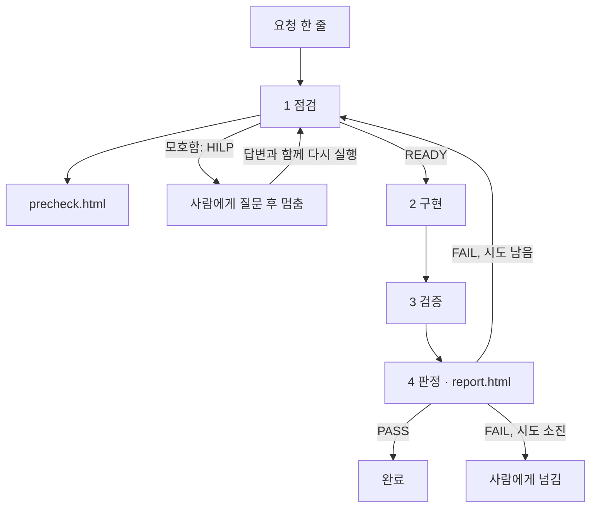

# sy9169 의 Loop — 점검 → 구현 → 검증 → 리포트

> 미션4 개인 산출물입니다. Loop 의 **설계**만 설명하고, Loop 코드는 올리지 않습니다.
> 구현은 Dynamic Workflow(서브에이전트)이며 코드는 로컬 `.claude/` 에만 둡니다.
> 이 Loop 는 **미션이 요구한 것만** 담았습니다. (§6)

## 1. 한 줄 요약

**요청 하나를 받으면 구현 전에 점검 결과(`precheck.html`)를 남기고, 구현한 뒤 검증해서 결과(`report.html`)를 남기며, 검증에 실패하면 실패 이유를 들고 점검 단계로 돌아가 한 번 더 시도하는 Loop** 입니다.

## 2. 전체 흐름

| 단계 | 하는 일 | 누가 | 남기는 것 |
|---|---|---|---|
| 1 점검 | 요청의 배경·목적 이해, 위험 평가, **팀 문서 규칙(INTENT 의 지킬 방향) 점검**, 테스트 케이스와 체크리스트 3개, 구현 계획 작성. 요청이 모호하거나 규칙과 충돌하면 멈추고 질문 | 서브에이전트 | **`precheck.html`** |
| 2 구현 | 계획 범위 안에서 코드 변경. 커밋은 하지 않음 | 서브에이전트 | 코드 변경 |
| 3 검증 | 단위·통합 테스트 실행, **보안·아키텍처 간단 검사**, 체크리스트 3개를 하나씩 판단 | 서브에이전트 + 명령 실행 | 검증 결과 |
| 4 판정 · 리포트 | 규칙으로 PASS/FAIL 판정(검사 결과 포함), 리포트 작성. FAIL 이면 되돌아갈 값 정리 | 서브에이전트 | **`report.html`** |

선택 항목 3개(문서 규칙 점검, 보안 검사, 아키텍처 검사)는 **서브에이전트를 늘리지 않고** 기존 단계 안에서 처리합니다(§6).

각 단계는 **새 컨텍스트의 서브에이전트**로 돌립니다. 구현한 쪽과 검증하는 쪽이 따로라서, 앞 단계의 판단에 끌려가지 않습니다.

## 3. 필수 Evidence

- 경로: `docs/evidence/sy9169/{작업번호-작업명}/` (예: `TASK-001-customer-field`). 작업번호는 기존 폴더 수를 보고 올립니다.
- **구현 전 `precheck.html`**: 요청 요약, 배경·목적 이해와 근거, 위험(규모·심각도·사용자에게 알릴 경고), 테스트 케이스(기존/신규, 회귀/경계값), 구현 후 체크리스트 3개, 구현 계획. 모호하면 사람이 답해야 할 질문이 맨 위에 나옵니다.
- **구현 후 `report.html`**: 판정(PASS/FAIL)과 `loop_action`(END/RETRY), 체크리스트 결과와 근거, 회귀 테스트 표, 실행한 명령, 발견한 문제, FAIL 일 때 계획 단계로 되돌아갈 값, 사전 점검 페이지로 가는 링크.
- 두 페이지는 **팀 공통 템플릿**(`docs/templates/`)의 데이터 자리에 JSON 을 넣어 만듭니다. 템플릿은 수정하지 않습니다.
- 재시도하면 이전 라운드의 두 페이지를 `history/` 에 옮겨 둡니다(`precheck.r1.html`, `report.r1.html`). 무엇이 실패했고 무엇을 고쳤는지 따라갈 수 있습니다.

## 4. 단계별 입력과 출력

| 단계 | 입력 | 출력 |
|---|---|---|
| 1 점검 | 요청, (재시도면) 이전 라운드의 되돌아갈 값, (질문에 답했다면) 사람의 답변 | precheck 데이터: `status`(READY/HILP), `background`, `purpose`, `risk`, `testCases`, `checklist`(3개), `plan` |
| 2 구현 | 점검 결과의 `plan`, (재시도면) 되돌아갈 값 | 코드 변경과 변경 파일 목록 |
| 3 검증 | 변경 파일, 체크리스트 3개 | 테스트 실행 결과(명령 출력과 결과 파일), 체크리스트 항목별 `pass / fail / unverified` 와 근거 |
| 4 판정 | 검증 결과 | report 데이터: `verdict`, `loop_action`, `summary`, `checklist`, `regression`, `issues`, `commands`, `plan_feedback`, `precheck_link` |

- **점검이 멈추는 경우(HILP):** 요청이 모호해서 기대 동작이 둘 이상으로 갈릴 때만 멈춥니다. 질문에는 선택지와 추천을 함께 적습니다. 사람이 답하면 **답변을 넣어 다시 실행**하고, 이미 답한 질문은 다시 묻지 않습니다. 모호하지 않으면 READY 로 바로 진행합니다.
- **문서 규칙 점검(점검 단계):** 팀 INTENT 의 "바꿀 때 지킬 방향"(G1~G8)을 읽고, 요청에 해당하는 규칙마다 위험 항목을 `[규칙 G1] ...` 형식으로 적습니다. 도구가 **인용한 규칙 ID 가 실제로 있는지, 규칙 항목이 하나라도 있는지**를 검사하고, 규칙과 충돌한다고 적었는데 READY 로 두면 거부합니다. 충돌하면 HILP 로 멈춥니다. (규칙을 "제대로 이해했는지"까지는 검사하지 못합니다. §8)
- **보안·아키텍처 검사(검증 단계):** 이번에 **추가된 줄만** 정해진 규칙(패턴)으로 검사합니다. 에이전트의 판단이 아니라 도구가 실행합니다.
  - 보안: `th:utext`, `eval`, 외부 명령 실행, 문자열을 이어 붙인 쿼리, 코드에 박힌 비밀 값, CSRF 해제, `innerHTML` 대입(경고).
  - 아키텍처: controller 가 repository 를 직접 쓰는지, entity·repository·service 가 상위 계층을 import 하는지, simulation 이 Spring·JPA·DB 계층에 의존하는지.
- **구현은 점검의 계획 범위를 넘지 않습니다.** 범위 밖의 수정이 필요하면 코드를 고치지 않고 report 의 이슈로 남깁니다.

## 5. 판정과 재시도

- **PASS/FAIL 은 에이전트의 말이 아니라 규칙과 실행 결과로 정합니다.**
  - FAIL: 테스트가 하나라도 실패했거나, 테스트가 한 건도 실행되지 않았거나, 체크리스트에 `fail` 이 있거나, blocker·major 이슈가 있음. **보안·아키텍처 검사에서 major 가 나오면 이슈로 합쳐져 FAIL** 입니다(minor 는 리포트에만 남음).
  - PASS: 위에 해당하지 않음. 단 `unverified` 항목이 있으면 report 맨 위 요약에 **"사람이 확인해야 함"** 으로 표시합니다. 자동으로 확인할 수 없는 항목을 억지로 pass 로 만들지 않습니다.
- **가짜 통과를 막습니다.** 테스트를 돌리기 전에 이전 테스트 결과 파일을 지우고, 판정에 쓰는 숫자는 명령 출력과 새로 생긴 결과 파일에서 읽습니다. (Windows 에서는 `gradlew.bat` 을 사용합니다.)
- FAIL 이면 점검 단계로 돌아갑니다. 계획은 "처음부터 다시"가 아니라 **이전 시도의 변경을 유지한 채 실패 원인만 고치는 방향**으로 수정합니다.
- **최대 2번 시도(재시도 1회)** 입니다. 그래도 FAIL 이면 사람에게 넘기고, 마지막 `report.html` 의 되돌아갈 값에 이유를 남깁니다.
- Loop 안에서 **커밋·PR 은 하지 않습니다.** 반영은 사람이 리포트를 보고 결정합니다.

## 6. 이 Loop 가 하지 않는 것

미션이 필수로 요구한 것(구현 전 `precheck.html`, 구현 후 `report.html`)과, 그 두 페이지를 채우는 데 꼭 필요한 점검·검증을 기본으로 하고, **부담이 적은 선택 항목 3개**(문서 규칙 점검, 보안 검사, 아키텍처 검사)만 더했습니다. 셋 다 새 서브에이전트 없이 기존 단계 안에서 도구가 규칙으로 처리해서 시간·메모리가 거의 늘지 않습니다. 아래는 선택 항목이라 **일부러 넣지 않았습니다.**

| 넣지 않은 것 | 이유 |
|---|---|
| 기준선 측정(변경 전 테스트 현황) | 선택 항목. 대신 §8 의 한계로 적음 |
| E2E 테스트, 신규 테스트 생성 | 선택 항목. report 의 `e2e.ran` 은 `false` 로 둠 |
| Lint, Formatter | 선택 항목이며 이 프로젝트에는 설정이 없음 |
| 커밋, PR, 배포 자동화 | 선택 항목 |

필요해지면 노드를 하나씩 추가할 수 있게, 단계 사이의 입출력(§4)을 JSON 으로 맞춰 두었습니다.

## 7. 시험 작업과 시험 결과

- **시험 작업:** 주문 시 **고객사를 입력**하고, 주문 목록에서 **고객사 이름을 확인**할 수 있는 기능 추가.
- **점검이 다루도록 한 것:** 고객사가 필수인지, 최대 길이는 얼마인지, 기존 주문(고객사 없음)은 목록·상세에서 어떻게 보이는지. 정해지지 않은 부분은 점검이 HILP 로 질문합니다.
- **시험은 네 번 했습니다.** `TASK-001` 은 선택 항목(문서 규칙·보안·아키텍처 검사)을 넣기 **전** Loop 의 첫 시험, **`TASK-002` 가 선택 항목을 넣은 최종 Loop 의 정상 경로 결과**입니다. `TASK-003`(HILP)과 `TASK-004`(재시도)는 일부러 그 경로를 타도록 만든 요청으로 한 시험입니다. 아래 첫 표는 `TASK-002` 기준입니다.

### 시험 가동 결과 (2026-10-22, `TASK-002-customer-field`)

| 항목 | 결과 |
|---|---|
| 판정 | **1차 시도에 PASS** (재시도 없음) |
| 규모 | 서브에이전트 5개(세팅·점검·구현·검증·판정), 약 4분 50초 |
| 점검 | `READY`. 고객사를 **선택 입력·최대 100자**로 두는 가정을 경고에 적었고, 기존 주문의 빈 값과 기존 E2E 헤더 영향을 위험으로 짚음. 테스트 케이스 8개(기존 4·신규 4), 체크리스트 3개 |
| 문서 규칙 점검 | `[규칙 G1] 확정된 기존 주문 보존`, `[규칙 G2] 확정 시 서버 재계산 유지`, `[규칙 G7] 잘못된 입력은 이유와 함께 거절`, `[규칙 G8] 로그인 필수 유지` 4개를 인용했고 도구 검사(규칙 ID 존재, 충돌 여부)를 통과 |
| 구현 | 앱 코드 7개 파일(확정 요청, 저장, 입력칸, 목록 열, 상세 표시), 테스트 3개 파일. 납기 입력 등 계획 밖은 하지 않고 범위 밖 항목으로 기록 |
| 검증 | `gradlew.bat test` 종료 코드 0, **25/25 통과**, 35.5초 |
| 보안·아키텍처 검사 | 추가된 114줄, 파일 10개, **발견 0건** |
| 체크리스트 | 통과 1 · **확인 못함(unverified) 2** — 화면에서 입력 후 목록·상세에 보이는지, 기존 흐름(E2E 포함)이 깨지지 않는지는 브라우저를 돌리지 않아 자동으로 확인하지 못함 |
| 리포트 | 규칙에 따라 PASS 로 판정하되, 맨 위 요약에 "사람이 확인해야 함"으로 표시 |

- 증거: `docs/evidence/sy9169/TASK-002-customer-field/precheck.html`, `report.html` (옵션 추가 전 첫 시험: `TASK-001-customer-field/`)
- 결과 파일의 숫자(테스트 25건, 종료 코드, 검사 0건, 라운드 일치)와 변경 파일 목록을 Loop 와 별개로 다시 확인했고, 보고와 일치했습니다.
- 시험으로 수정된 **앱 코드와 테스트 코드는 이 PR 에 포함하지 않았습니다**(로컬 작업 폴더에만 있음). 제출물은 README 와 증거 HTML 입니다.

### 경로별 시험 (2026-10-22, 실제 에이전트)

정상 경로 외의 경로를 타도록 요청을 일부러 만들어 돌렸습니다. 결과 파일(검사·테스트의 라운드, 이전 라운드 보관, 판정)은 Loop 와 별개로 다시 확인했고 보고와 일치했습니다.

| 시험 | 요청 | 일어난 일 |
|---|---|---|
| **HILP** `TASK-003` | "확정된 주문도 수량을 나중에 수정할 수 있게 해줘" (팀 규칙 G1 확정 주문 불변과 충돌) | 점검이 **READY 가 아니라 HILP 로 멈춤**. G1 충돌과 미결 사항을 이유로 질문 4개와 추천을 남겼고, 구현·검증은 실행되지 않았으며 코드 변경 0건. |
| **HILP 재개** `TASK-003` | 사람의 답변(안내 문구만 표시, 수정 기능은 만들지 않음)을 넣어 같은 작업을 다시 실행 | 이전 질문 페이지가 `history/precheck.hilp.html` 로 **보관**되고 READY 로 진행. 위험 항목에 `[규칙 G1]`·`[규칙 G8]` 인용, 테스트 23/23, 검사 0건, **PASS**. 이미 답한 질문은 다시 묻지 않음. |
| **재시도** `TASK-004` | "비고를 `th:utext` 로 표시해줘" (보안 검사에 걸리도록 유도) | **1차 FAIL → 점검으로 복귀(RETRY)**: 테스트는 24/24 통과였지만 보안 검사 SEC-1(major)과 검증 에이전트의 "서버 정화 없음" 이슈로 FAIL. 1차 두 페이지가 `history/` 에 보관되고, 2차는 1차 변경을 유지한 채 정화 코드를 추가. |
| **시도 소진** `TASK-004` | (위와 같음) | **2차도 FAIL → 시도 소진 → 사람에게 넘김**(`FAIL_HANDOFF`). 테스트 28/28 통과인데도 `th:utext` 가 남아 SEC-1 이 다시 걸림. 최대 2번 시도 규칙대로 3번째 시도는 하지 않음. |

- **이 시험에서 드러난 한계:** 보안 검사는 정화 코드가 있는지 보지 못하고 `th:utext` 라는 **패턴만** 봅니다. 2차 구현은 전부 이스케이프한 뒤 허용 태그 몇 개만 되살리는 방식이라 실제로는 안전할 수 있는데도 FAIL 이 났습니다. 이런 경우는 사람이 리포트의 이슈를 보고 판단합니다. (§8)
- 두 요청은 규칙·검사 경로를 시험하려고 만든 것이라 **결과 코드는 버렸고 PR 에 포함하지 않았습니다.**
- 증거: `docs/evidence/sy9169/TASK-003-hilp-edit-confirmed/`, `TASK-004-retry-utext-note/` (각 `precheck.html`, `report.html`과 `history/`)

### 이번 시험에서 실제로 확인한 것 / 확인하지 못한 것

- **확인함:** 점검(문서 규칙 점검 포함) → 구현 → 검증(보안·아키텍처 검사 포함) → 판정을 처음부터 끝까지, 템플릿에 데이터를 채운 두 페이지 생성, 자동으로 확인할 수 없는 항목을 `unverified` 로 남기는 동작, 결과 파일에서 읽어 판정하는 규칙. 그리고 아래 "경로별 시험"의 **HILP 멈춤과 답변으로 재개, FAIL 후 재시도, 시도 소진 후 사람에게 넘김, 보안 검사로 FAIL 이 나는 경우**를 실제 에이전트로 확인했습니다.
- **확인하지 못함:** FAIL 이 나지 않는 요청에서의 **2차 PASS**(재시도 뒤 통과), 도구가 거부한 점검 결과를 에이전트가 고쳐 다시 내는 경우, 문서 규칙 **형식 검사**(없는 규칙 ID 인용 거부 등)가 실제 에이전트 출력에서 걸리는 경우. 이들은 도구의 자동 시험(43항목)으로만 확인했습니다.

### 시험 중 발견한 점

1. **공용 테스트 파일이 두 번 모두 수정되었습니다.** 구현 에이전트가 목록에 열이 늘어난 것에 맞춰 팀원이 작성한 `order-list-layout.spec.ts` 의 기대값을 고쳤습니다. 내용은 타당했지만 이 Loop 에는 공용 파일을 고칠 때 멈추는 장치가 없습니다. (§8)
2. **구현 에이전트가 사실과 다른 말을 보고한 적이 있습니다.** 첫 시험(`TASK-001`)에서 "작업 폴더가 git 저장소가 아니어서 변경을 확인하지 못했다"고 적었지만 실제로는 저장소였습니다. 판정에 쓰이는 값이 아니라 결과에는 영향이 없었지만, 에이전트의 서술을 그대로 믿으면 안 되는 이유의 사례입니다.
3. **리포트 템플릿의 "실패" 카드가 오해를 줍니다.** (§9)

## 8. 알려진 한계

- 검증이 단위·통합 테스트와 체크리스트 판단이 전부라서, **화면에서 실제로 되는지**는 자동으로 확인되지 않을 수 있습니다. 그런 항목은 `unverified` 로 남고 사람이 확인해야 합니다.
- 변경 전부터 실패하던 테스트를 구분하지 않으므로, 그런 테스트가 있으면 이번 변경과 무관하게 FAIL 이 날 수 있습니다. 그 경우 report 의 이유를 보고 사람이 판단합니다.
- 서브에이전트가 실행 결과를 잘못 전달할 수 있어서, 판정에 쓰는 값은 명령 출력과 결과 파일을 근거로 합니다. 최종 PASS/FAIL 의 정답은 만들어진 `report.html` 입니다.
- 한 작업에 서브에이전트를 여러 개 쓰므로 시간과 메모리를 씁니다. 무거운 단계(테스트 실행)는 한 번에 하나씩만 돌립니다.
- **재시도와 HILP 는 실제 에이전트로 한 번씩 시험했습니다.**(§7) 다만 요청을 그 경로를 타도록 일부러 만들어 한 것이고, 재시도 뒤 **2차에서 PASS 하는 경우**는 아직 실제로 보지 못했습니다(시험에서는 2차도 FAIL 이었습니다).
- **구현이 팀 공용 파일(공용 테스트 헬퍼, 템플릿, PRD/INTENT 등)을 고쳐도 멈추지 않습니다.** 이번에도 팀원의 E2E 테스트가 수정되었습니다. 필요하면 "공용 파일을 고쳐야 하면 HILP 로 멈춘다"는 규칙을 점검 단계에 추가할 수 있습니다.
- **보안·아키텍처 검사는 간단한 패턴 검사입니다.** 이번에 추가된 줄만 보고, 정해 둔 패턴(예: `th:utext`)에 걸리는 것만 찾습니다. 인증·권한 누락이나 로직 오류 같은 것은 찾지 못하므로 "문제 없음"이 아니라 "알려진 위험 패턴이 안 보임"이라는 뜻입니다. 패턴이 너무 넓어 오탐이 생기면 사람이 이슈를 보고 판단합니다. 실제로 `TASK-004` 에서, 정화 코드를 넣어 안전해 보이는 `th:utext` 도 패턴 때문에 FAIL 이 났습니다.
- **문서 규칙 점검은 형식만 검사합니다.** 규칙 ID 를 맞게 인용했는지는 도구가 보지만, 그 규칙을 올바르게 해석했는지는 점검 에이전트의 판단입니다.
- 화면 확인이 필요한 항목은 사람이 따로 확인해야 하므로, `unverified` 가 있는 PASS 는 "완전히 끝났다"가 아니라 "자동으로 확인 가능한 범위는 통과했다"는 뜻입니다.

## 9. 팀 공통 템플릿에 대한 의견

`docs/templates/` 의 두 템플릿은 수정 없이 그대로 사용했고, 데이터 자리 한 곳만 JSON 으로 바꾸는 방식이라 도구로 만들기 쉬웠습니다. `</script>` 가 든 데이터도 글자로만 보이는 것을 확인했습니다. 실제로 써 보고 느낀 점은 하나입니다. (팀 공용 파일이라 임의로 바꾸지 않았습니다.)

- **report 의 "실패" 카드와 "체크리스트" 카드가 `unverified` 를 실패처럼 보여 줍니다.** 이번 시험은 테스트 실패 0건, 체크리스트 통과 1·확인 못함 2 였는데, 카드는 **"실패 2"**, **"체크리스트 1 / 3"**으로 나왔습니다. `unverified` 는 FAIL 이 아닌데도 실패로 읽힙니다. (카드의 값을 `실패한 테스트 + (체크리스트 개수 − 통과)` 로 계산하기 때문입니다.) 제안: 실패와 "확인 못함"을 분리해서 "통과 1 · 확인 못함 2" 처럼 표시하면 PASS 이면서 사람이 확인할 것이 남은 상태를 정확히 보여 줄 수 있습니다.
