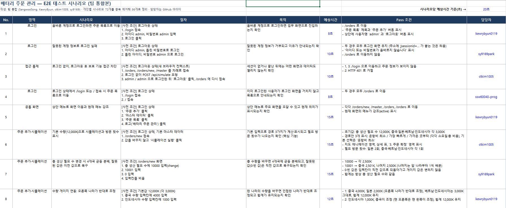

# 1. 테스트 세팅

<!-- 2026-10-23 main 에서 `./gradlew test` 와 `npx playwright test`(인메모리 DB 서버, 포트 8082)를 직접 실행한 결과입니다. -->
<!-- 세팅한 테스트의 종류별 개수와 테스트 도구를 적으세요. 세팅하지 않은 테스트는 개수에 0을 적거나 행을 지우세요. -->

| 테스트 | 개수 | 테스트 도구 |
|---|:-:|---|
| Unit Test | 14개 (전부 통과) | JUnit 5, AssertJ (`PlannerTest` 12개, `PlannerGoldenTest` 2개) |
| Slice Test | 0개 | - |
| 통합 테스트 | 151개 (전부 통과) | `@SpringBootTest` + MockMvc, 인메모리 H2 |
| E2E 테스트 | 59개 (전부 통과) | Playwright (TypeScript, Chromium), 인메모리 DB 서버 (Robustness 제외) |
| Robustness 테스트 | 7개 (전부 통과) | Playwright, 견고성 시나리오 S1·S3·S4·S5·S7·S8·S10 |
| Stress 테스트 | 0개 | - |
| 성능 테스트 | 0개 | - |
| Test Coverage | 측정 안 함 | - |

 

## 테스트 시나리오

<!-- 아래 샘플 이미지를 팀이 제작한 테스트 시나리오 캡처로 교체하세요. 캡처는 presentation/assets/에 올리고 파일명을 맞추세요. -->

팀 E2E 시나리오는 팀 통합본 36개로 정리해 담당자를 나눠 구현했습니다(PR #17). 견고성 시나리오는 로그인 없는 접근, 수량·메모 경계값, 기준값 변경 뒤 확정 거절, 없는 주문 접근 등 S1~S10 중 현재 main 에 구현된 7개 테스트입니다(PR #13).

아래는 테스트 시나리오 캡처입니다.

---

[← 목차](README.md) · [다음: Loop 설계 →](02-loop.md)
