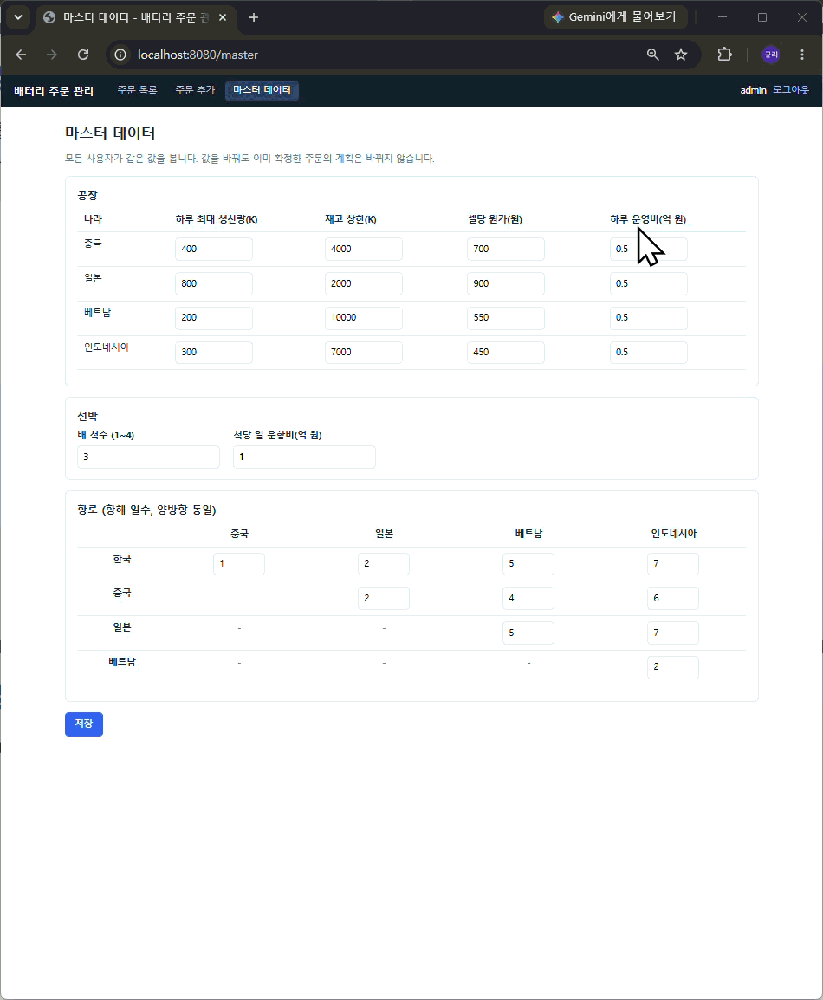
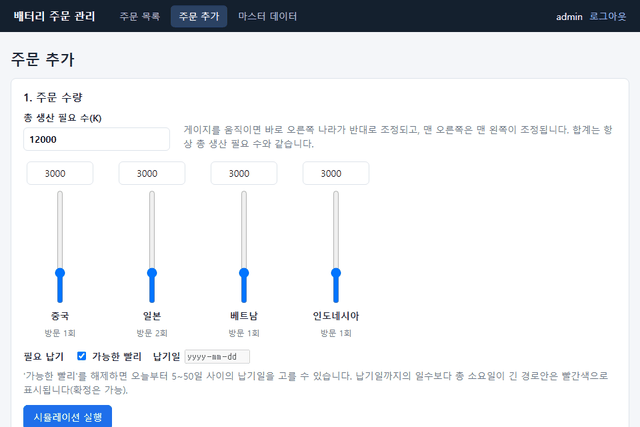

# 3. 기능 추가 미션 동작 영상

기능 추가를 한 결과 시연 영상을 살펴봅니다.

GIF는 화면에서 바로 재생되지만, mp4는 다운로드한 후 별도의 플레이어로 실행해야 합니다.

<!-- 아직 팀이 찍은 GIF/mp4가 없어 영상 자리는 비워 두었습니다. 파일을 presentation/assets/ 에 넣고 아래 주석 줄의 주석을 풀어 사용하세요. -->

 

## 기능 1. 회원 가입

가입 코드를 아는 사람이 아이디·비밀번호로 가입하고, 로그인은 회원 테이블(DB)을 조회합니다. 비밀번호는 BCrypt로 저장하며, 기존 `admin` 계정과 주문 이력은 그대로 유효합니다. (Red, 박상윤 · [PR #30](https://github.com/sds-code-reviewer-26-8/battery-2-team/pull/30))

<!--  -->
<!-- ▶ [signup.mp4](assets/signup.mp4) -->

 

## 기능 2. 주문 고객사 입력·수정

주문 확정 때 고객사(필수, 100자 이하)를 입력하고, 확정 후에도 상세 화면에서 고칠 수 있습니다. 완료·취소된 주문은 수정할 수 없습니다. (Yellow, 송상우 · [PR #31](https://github.com/sds-code-reviewer-26-8/battery-2-team/pull/31))

<!--  -->
<!-- ▶ [customer.mp4](assets/customer.mp4) -->

 

## 기능 3. 공장 운영비

master 화면에서 공장별 하루 운영비(기본 10억)를 설정하고, 시뮬레이션이 이를 반영합니다. COST 안은 총 비용(생산원가 + 운항비 + 운영비) 최소로 고릅니다. (Red, 변규리 · [PR #32](https://github.com/sds-code-reviewer-26-8/battery-2-team/pull/32))

<!--  -->
<!-- ▶ [operating-cost.mp4](assets/operating-cost.mp4) -->

 

## 기능 4. 필요 납기일 지정

'가능한 빨리' 체크 또는 오늘 기준 5~50일 납기를 선택하고, 납기일을 넘기는 경로안은 빨간색으로 표시합니다. (Yellow, 김춘택 · [PR #33](https://github.com/sds-code-reviewer-26-8/battery-2-team/pull/33))

▶ [due-date.mp4](assets/due-date.mp4)

---

[← 이전: Loop 설계](02-loop.md) · [목차](README.md) · [다음: PR & 코드리뷰 →](04-review.md)
